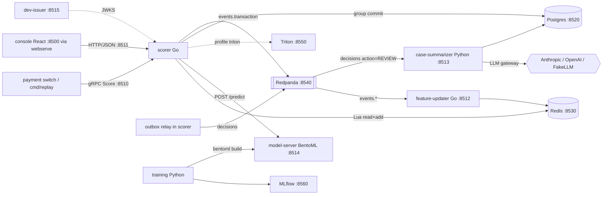
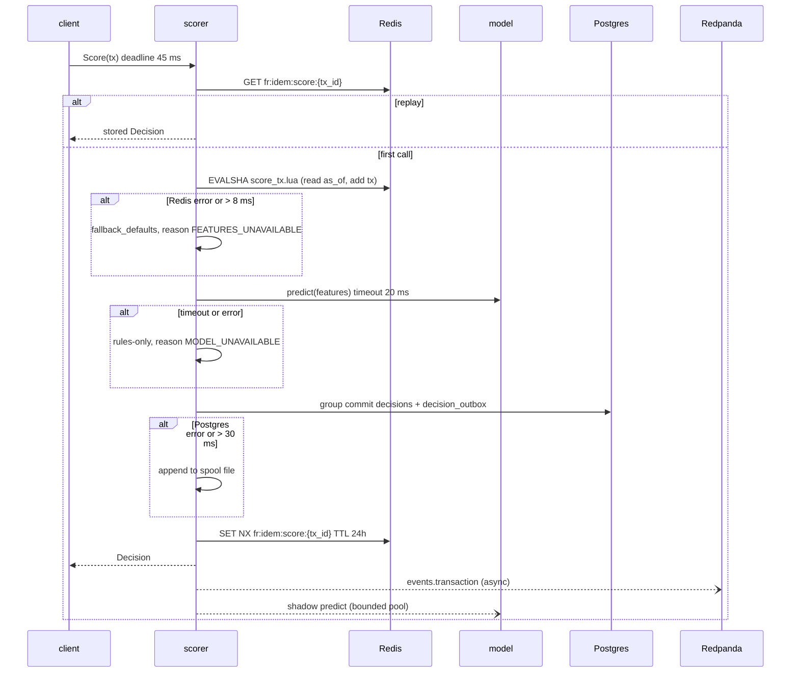
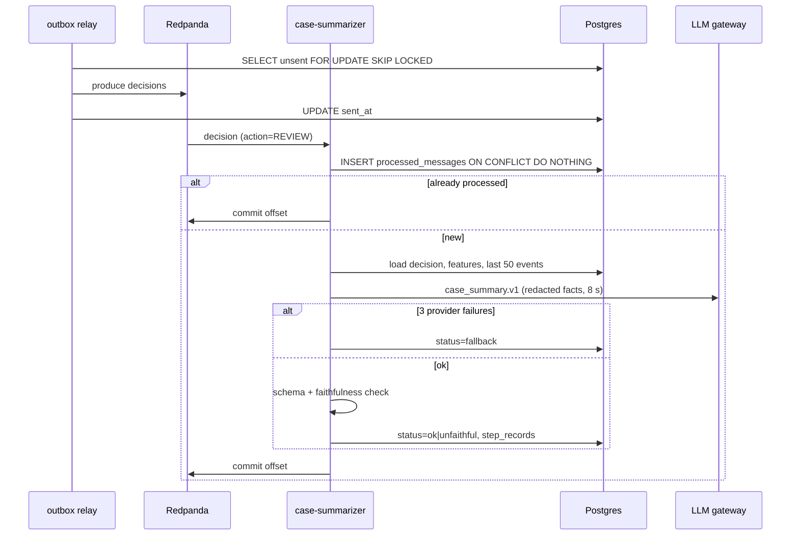

# BUILD: fraud-scoring-service

> **How to run this file.** Put this file alone in an empty folder (local run) or at the root of an empty GitHub repository (Claude Code on the web). Start Claude Code there and send:
> `Read BUILD.md and execute it end to end. Do not stop until every item in the Global Definition of Done is checked.`
> This file is the complete specification. Everything needed to build, test, document and verify the repository is here.

## 0. Operating mode

You are the only engineer on this repository and you work autonomously from the first command to the final verification. Nobody will answer questions while you work.

1. **Do not stop early.** Do not end your turn while any item in §9 Global Definition of Done is unchecked. When you believe you are finished, run §19 Final verification; if anything fails or is unchecked, keep working. The only valid early stop is a hard blocker under §20.

2. **Decide, don't ask.** When something is ambiguous, choose the option that best serves §2 Product brief, record it in `docs/DECISIONS.md` (date, decision, alternatives, reason) and continue. Architectural choices also get an ADR in `docs/adr/`.

3. **Progress lives in the repository.** In M0, create `PROGRESS.md` with a "Needs the maintainer" section at the top, every task from §8 (ID, title, status, evidence), and the Global Definition of Done from §9 as a checklist; check items there, never in this file. Update it after every task and mirror it in your task-tracking tool if you have one. After a context compaction, a restart or a new session, first re-read `BUILD.md` (or `docs/specs/000-build-spec.md`), `PROGRESS.md`, `docs/DECISIONS.md` and `git log --oneline -30`, then resume from the first unchecked task. Never redo finished work.

4. **Small verified increments.** For each task: write the failing test first, implement, run the relevant checks, record evidence in `PROGRESS.md` (the command and a one-line result), and commit with a Conventional Commit message. Never leave the branch red between tasks.

5. **Push often when a remote exists.** After every milestone run `git push -u origin <current-branch>`, retrying network failures up to 4 times with backoff (2, 4, 8, 16 seconds). The container can be reclaimed and unpushed work is lost. Push only the current branch and never force-push.

6. **Honesty over appearance.** Never invent metrics, eval scores, benchmark numbers, screenshots or test results. Every number in the README and docs comes from a command you ran, cited next to it. Never skip, disable, mark as expected-failure or weaken a test or threshold to get green: fix the code, or record the gap in `docs/KNOWN_LIMITATIONS.md`.

7. **Offline first.** Every test, the demo and `make verify` must pass with no API keys and no paid services, using the deterministic fakes and recorded fixtures. Live model calls exist only behind `make eval-live`: it reads keys from the environment, prints the estimated cost first, and stops at `LIVE_EVAL_BUDGET_USD` (default 2). Run it once at the end only if the provider key is set; otherwise the eval report states that live evals were not run.

8. **Safety rails.** Never run `terraform apply` or `terraform destroy`, never deploy to a cloud account, never create, publish or change the visibility of a GitHub repository, never send messages to real recipients (email, SMS, Slack, voice), never commit secrets or real personal data. Synthetic data only. Never change the git identity, and never add Claude attribution to commits or pull requests (§1.1).

9. **Use the harness you build.** From the end of M0, use the subagents, skills, rules and hooks you created in `.claude/` (§7). Run the `reviewer` subagent at the end of every milestone and fix its blockers before moving on. Use parallel subagents only for independent read-heavy work (research, reviews, audits), never for two agents editing the same files. If a subagent or skill you created is not loaded in this session yet, run a general-purpose subagent with that file's instructions, or follow the `SKILL.md` steps by hand.

10. **Use Claude Code's bundled skills when they are available:** `claude-api` before writing any code that calls Claude; `session-start-hook` to build the cloud SessionStart hook; `run` to launch the app and capture screenshots; `code-review`, `security-review` and `simplify` in the final hardening milestone. If one is not available, do the equivalent by hand.

11. **Keep the context lean.** Don't print large files or long logs into the conversation; summarize command output and write long notes to files.

12. **Ownership.** All code is new and MIT licensed. Do not copy code beyond what its license allows, attribute any adapted snippet in a comment, and do not name any real employer, client or product of the maintainer.

## 1. Environment bootstrap

1. **Detect the environment.** `CLAUDE_CODE_REMOTE=true` means Claude Code on the web (apply Appendix A); otherwise local. Record OS, CPUs, memory and versions of `go`, `python3`, `uv`, `node`, `pnpm`, `docker`, `buf`, `terraform` (or "missing") in `docs/DEVELOPMENT.md`.
2. **Repository.** If `git rev-parse --is-inside-work-tree` fails, run `git init -b main`. Never change the remote or the git identity.
3. **Pre-seeded repository.** The maintainer's initial commit already contains `BUILD.md`, a placeholder `README.md`, `LICENSE`, `.gitignore`, `.claude/settings.json` (with the `attribution` key and a starter permission list) and `.claude/rules/git-commits.md`. If both files already exist with the required content, §1.1 steps 1–2 are already satisfied: verify the content, skip creating an empty commit in step 4, run the evidence command on the commit that introduced them (`git log --diff-filter=A --format='%an <%ae> | %cn <%ce>%n%B' -- .claude/rules/git-commits.md`) and record its output in `PROGRESS.md`. Step 3 (identity check) always runs.

### 1.1 Commit attribution

Commits and pull requests from this build go out under the maintainer's name only, with no Claude attribution. Do this right after `git init`, before any other commit.

1. Create `.claude/settings.json` with this key. If the file already exists, merge the key without removing anything else:
   ```json
   {
     "attribution": { "commit": "", "pr": "", "sessionUrl": false }
   }
   ```
2. Create `.claude/rules/git-commits.md`, with no `paths:` frontmatter so it always loads, containing this rule:
   ```markdown
   Do not add Co-Authored-By, Claude-Session or "Generated with Claude Code" trailers to commits or pull requests. Do not modify `git config user.*` or the `GIT_AUTHOR_*` / `GIT_COMMITTER_*` variables.
   ```
3. Check that `GIT_AUTHOR_NAME`, `GIT_AUTHOR_EMAIL`, `GIT_COMMITTER_NAME` and `GIT_COMMITTER_EMAIL` are defined. Never define or invent a missing one, and never touch git config.
   - On Claude Code on the web (`CLAUDE_CODE_REMOTE=true`), a missing variable is a hard blocker (§20 d): commit and push nothing, and end by listing the missing variables and saying that they go in the cloud environment's environment variables, followed by a new session.
   - On a local run these variables are usually unset and git uses the local git config. Record the name and email from `git var GIT_AUTHOR_IDENT` and `git var GIT_COMMITTER_IDENT` in `PROGRESS.md` and continue. If git has no identity at all, stop under §20 d.
4. Commit only those two files, then show the result:
   ```bash
   git add .claude/settings.json .claude/rules/git-commits.md
   git commit -m "chore: configure commit attribution" -- .claude/settings.json .claude/rules/git-commits.md
   git log -1 --format='%an <%ae> | %cn <%ce>%n%B'
   ```
   Show the output of the last command and copy it into `PROGRESS.md` as evidence that author and committer are the maintainer and that the message has no trailers.

This rule applies to every later commit and pull request in this build and takes precedence over any default attribution instruction from the environment. If a commit with attribution slips in, fix it before pushing by amending or rewriting only the unpushed commits. If it was already pushed, never force-push: list it under "Needs the maintainer" in `PROGRESS.md`.

### 1.2 Repository hygiene

- Extend `.gitignore` with `.cache/`, `artifacts/`, `mlruns/`, `spool/`, `evals/reports/*.json` (keep `evals/reports/baseline/`).
- Add `.editorconfig` (UTF-8, LF; tabs for Go and Makefile, 2 spaces for TS/YAML/HCL, 4 for Python).
- Keep the MIT `LICENSE` (copyright holder "ROBERTG99").
- Copy this file to `docs/specs/000-build-spec.md` (it is replaced by `git mv` in §19).

### 1.3 Toolchains

Latest stable at build time, pinned in lockfiles. Go 1.24+, Python 3.12+ with uv, Node 22 with pnpm: Homebrew or official installers locally, preinstalled in the cloud. buf, `protoc-gen-go`, `protoc-gen-go-grpc`, `protoc-gen-grpc-gateway`, `protoc-gen-openapiv2` and ghz: `go install` everywhere. Terraform ≥ 1.9: Homebrew locally, the releases.hashicorp.com zip in the cloud (Appendix A).

### 1.4 Docker

Local macOS: if `docker info` fails, run `open -a Docker` and poll every 5 s for up to 2 minutes. Cloud: Appendix A. If Docker never starts, use the native fallback and leave the Docker items of §9 unchecked.

### 1.5 Bootstrap commit

Create `PROGRESS.md` (§0 rule 3), `docs/DECISIONS.md` and `docs/DEVELOPMENT.md`, then commit with `chore: bootstrap repository`.

## 2. Product brief

**Problem.** A fictional card-issuing fintech decides transactions with a hand-tuned rules engine, and analysts reconstruct each review case from raw event logs. Synthetic baseline (synthetic assumption): rules catch 60% of fraud at a 3% false-positive rate; 1,500 review cases per day at 4 minutes each; scoring p95 is 180 ms because features are computed by SQL per request.

**Users and roles.** `analyst` (review queue, labels), `risk_engineer` (rules, thresholds, shadow), `ml_engineer` (training, registry), `service` (the payment switch calling `Score`).

**Business metric.** Recall at 1% FPR from 60% to ≥ 80% on the temporal test split, review volume −40% at equal recall, scoring p95 from 180 ms to < 50 ms (measured by `make eval` and `make bench` on synthetic data).

**Why AI, and where not.** A calibrated GBDT model decides (fast, auditable); an LLM only writes asynchronous case summaries whose cited facts are verified by code, and it can never change, delay or block a decision.

## 3. Scope and requirements

### 3.1 Functional requirements

**FR-1 Score API.** gRPC `fraud.v1.Scorer/Score` returns `Decision{action APPROVE|REVIEW|DECLINE, score, reason_codes, model_version, rules_version, latency_ms}`; grpc-gateway exposes `POST /v1/score`.
- Given a transaction, when `Score` is called twice with its `transaction_id`, then both return the same `decision_id`.

**FR-2 Event streams.** Redpanda topics `events.login`, `events.device`, `events.transaction`, `decisions` (12 partitions, key `account_id`, JSON validated against `schemas/events/`).
- Given an invalid event, when consumed, then it lands in `events.dlq` with the error and the offset is committed.

**FR-3 Online features.** The feature-updater (one goroutine per partition) keeps point-in-time sliding-window features in Redis: tx count 10 min/1 h/24 h, amount sum 1 h, distinct devices 24 h, new device, minutes since password/email change, merchant-category novelty.
- Given out-of-order events within 5 minutes, when features are read as of a transaction timestamp, then only earlier events count.
- Given the 5,000-event parity fixture, when Go online and Python offline features are computed, then all values match exactly.

**FR-4 Synthetic data.** `cmd/gen` (seed 7) emits 2,000,000 (eval) or 200,000 (demo) events: account takeover, card testing, mule accounts and friendly fraud at 0.8% fraud; temporal split 70/15/15 by day.
- Given seed 7 and size `demo`, when generated twice, then both outputs have the same SHA-256.

**FR-5 Training and registry.** XGBoost (fallback HistGradientBoosting), isotonic calibration on the valid split, ONNX export, MLflow tracking and registry model `fraud-gbdt` with aliases `production` and `shadow`.
- Given the demo dataset, when `make train` runs, then it finishes in < 90 s and registers a version with `pr_auc` and `recall_at_1pct_fpr`.

**FR-6 Model serving.** BentoML `model-server` (onnxruntime) by default; Triton (KServe v2) in profile `triton`; both behind Go interface `internal/model.Client`.
- Given the golden vector, when scored through each client, then scores agree within 1e-5 (Triton skipped with a recorded reason if unavailable).

**FR-7 Rules and combination.** Versioned YAML rules (`fraud.rules.v1`) with reason codes, combined with the model band by a threshold table.
- Given rule `R003` matches and the model scores 0.10, when combined, then the action is REVIEW with `CARD_TESTING_BURST`.

**FR-8 Graceful degradation.** Model timeout 20 ms → rules-only with `MODEL_UNAVAILABLE`; Redis down → conservative defaults biased to REVIEW with `FEATURES_UNAVAILABLE`; Postgres down → disk spool.
- Given the model server sleeps 50 ms, when `Score` is called, then it returns within 35 ms with `MODEL_UNAVAILABLE` and `model_version = "none"`.

**FR-9 Shadow mode.** A second model version is scored asynchronously and compared in `shadow_comparisons`, never affecting the decision.
- Given the shadow backend errors on every call, when 1,000 transactions are scored, then every Decision equals the run with shadow disabled.

**FR-10 Decision persistence.** Group commit writes `decisions` and `decision_outbox` in one transaction before responding; a relay publishes `decisions` at least once.
- Given the relay crashes after producing but before marking rows sent, when it restarts, then duplicates carry the same `decision_id` and consumers ignore them.

**FR-11 Case summarizer.** A Python worker turns REVIEW decisions into `{pattern, evidence[{fact_key, statement}], recommended_checks[], confidence}` via the LLM gateway (Anthropic or OpenAI; FakeLLM offline), checked for faithfulness by code.
- Given a REVIEW decision, when processed, then a schema-valid summary with model, prompt version and faithfulness is stored and the decision row is unchanged.
- Given three provider failures, when the worker gives up, then the case gets a templated non-AI fact list, status `fallback`.

**FR-12 Cloud training launcher.** `training/sagemaker_launch.py --dry-run` prints the `CreateTrainingJob` request; Terraform module `sagemaker_training` creates the execution role, artifacts bucket and ECR repository.
- Given no AWS credentials, when `make sagemaker-dry-run` and `terraform test` (`mock_provider "aws"`) run, then valid request JSON prints and the encryption, public-access and no-wildcard-IAM assertions pass.

**FR-13 Analyst console.** React + Vite: sign-in, review queue, case detail with reason codes and the labelled AI summary, account timeline, shadow comparison, live metrics, rules viewer.
- Given an analyst confirms a label preview, when saved, then one `analyst_labels` and one `audit_log` row are written and the case leaves the queue.

### 3.2 Non-functional requirements

| ID | Requirement | Target | Measured by |
|---|---|---|---|
| NFR-1 | `Score` on a laptop at 2,000 RPS | p95 < 50 ms, p99 < 90 ms | `make bench BENCH_PROFILE=laptop` |
| NFR-2 | `Score` in CI at 300 RPS | p95 < 80 ms (gated) | `make bench` |
| NFR-3 | Feature-updater throughput | ≥ 10,000 events/s | `BenchmarkUpdater` |
| NFR-4 | Model server, single row | p95 < 8 ms | `make bench-model` |
| NFR-5 | Summary | live p95 < 6 s and ≤ USD 0.003/case; offline p95 < 200 ms | summary eval report |
| NFR-6 | Startup | `make up` + `make seed` (incl. training < 90 s) under 5 min | `scripts/time_startup.sh` |
| NFR-7 | Durability | 0 lost decisions when the scorer is killed under 1,000 RPS | `TestDurabilityKill` |
| NFR-8 | Resources | scorer RSS < 256 MB; image < 40 MB | bench, `docker image inspect` |
| NFR-9 | Limits | body ≤ 64 KB; 20 req/s per user | contract tests |
| NFR-10 | Privacy, access | 0 PII to LLM providers; role JWT on console APIs | `test_no_pii_reaches_provider` |

### 3.3 Out of scope

Managed feature store, automatic retraining, chargeback ingestion, case workflow beyond labels, real `terraform apply` or SageMaker submission, GPU serving.

### 3.4 User journeys

**Main (analyst).** (1) A USD 940 online purchase arrives from a new device 2 minutes after an email change. (2) The model returns 0.62, rule `R001` matches, and the decision is REVIEW with `NEW_DEVICE_AFTER_CREDENTIAL_CHANGE` and `MODEL_SCORE_ELEVATED` in < 50 ms. (3) The summarizer writes pattern `account_takeover` with three verified evidence items. (4) The analyst opens the case, clicks evidence to highlight its fact, and labels it fraud after confirming the row preview.

**Risk engineer.** Enables shadow for a new version, reviews agreement on the comparison page, records the promotion decision.

**Degradation.** `make demo` stops the model server; live metrics show `MODEL_UNAVAILABLE` rising while decisions continue rules-only.

## 4. Architecture

### 4.1 Components



- **scorer** (`cmd/scorer`): gRPC 8510, HTTP 8511. Validate → idempotency → features (Redis Lua) → model (20 ms) → rules → combine → group commit → respond; then async publish and shadow scoring. Hosts `CaseService` and the outbox relay.
- **feature-updater** (8512), **model-server** (BentoML + onnxruntime, aliases `production`/`shadow` from MLflow), **triton** (profile, ONNX Runtime CPU backend), **case-summarizer** (FastAPI + aiokafka), **mlflow** (Postgres database `mlflow`), **dev-issuer** (8515, personas `analyst-1`, `risk-1`, `ml-1`), **webserve** (8500, serves `web/dist`, proxies `/api/*` to 8511), **seed** job (migrate, generate, train, register, replay 24 h).

### 4.2 Sequence: score with degraded paths



### 4.3 Sequence: review case summary



### 4.4 Contracts

**Protobuf** (`proto/fraud/v1/scorer.proto`, `proto/fraud/v1/cases.proto`; buf lint `STANDARD`, `buf breaking` against `main` in CI):

```proto
syntax = "proto3";
package fraud.v1;
option go_package = "github.com/ROBERTG99/fraud-scoring-service/gen/go/fraud/v1;fraudv1";
import "google/api/annotations.proto";
import "google/protobuf/timestamp.proto";

enum Action { ACTION_UNSPECIFIED = 0; ACTION_APPROVE = 1; ACTION_REVIEW = 2; ACTION_DECLINE = 3; }
enum Channel { CHANNEL_UNSPECIFIED = 0; CHANNEL_CARD_PRESENT = 1; CHANNEL_ECOMMERCE = 2; CHANNEL_P2P = 3; }

message Transaction {
  string transaction_id = 1;              // UUIDv7, idempotency key
  string account_id = 2;                  // synthetic token
  int64 amount_minor = 3;                 // 1 to 10_000_000
  string currency = 4;                    // ISO 4217 allowlist
  string merchant_id = 5;
  string mcc = 6;                         // 4 digits
  Channel channel = 7;
  string device_id = 8;                   // salted SHA-256
  string ip_prefix = 9;                   // /24 only
  string country = 10;                    // ISO 3166-1 alpha-2
  google.protobuf.Timestamp event_ts = 11;
}
message ScoreRequest { Transaction transaction = 1; bool explain = 2; }
message Decision {
  string decision_id = 1;
  string transaction_id = 2;
  Action action = 3;
  float score = 4;                        // calibrated probability; -1 when model unavailable
  repeated string reason_codes = 5;
  string model_version = 6;               // "none" when degraded
  string rules_version = 7;
  float latency_ms = 8;
  bool degraded = 9;
  map<string, double> features = 10;      // only when explain = true
  google.protobuf.Timestamp decided_at = 11;
}
service Scorer {
  rpc Score(ScoreRequest) returns (Decision) {
    option (google.api.http) = { post: "/v1/score" body: "*" };
  }
}
service CaseService {
  rpc ListCases(ListCasesRequest) returns (ListCasesResponse);                 // GET  /v1/cases
  rpc GetCase(GetCaseRequest) returns (Case);                                  // GET  /v1/cases/{case_id}
  rpc LabelCase(LabelCaseRequest) returns (Case);                              // POST /v1/cases/{case_id}:label
  rpc GetTimeline(GetTimelineRequest) returns (Timeline);                      // GET  /v1/accounts/{account_id}/timeline
  rpc GetShadowSummary(GetShadowSummaryRequest) returns (ShadowSummary);       // GET  /v1/shadow/summary
  rpc GetActiveRuleSet(GetActiveRuleSetRequest) returns (RuleSet);             // GET  /v1/rules/active
  rpc TestRule(TestRuleRequest) returns (TestRuleResponse);                    // POST /v1/rules:test
  rpc StreamLiveMetrics(StreamLiveMetricsRequest) returns (stream LiveMetrics); // GET /v1/metrics/live
}
```

Comments give the `google.api.http` mappings. Key messages: `Case{case_id, decision, status, priority, facts, summary, label}` where summary carries `pattern, evidence[{fact_key, statement, verified}], model, prompt_version, faithfulness`; `LabelCaseRequest{case_id, label FRAUD|LEGIT, note ≤ 2000, idempotency_key}`; `LiveMetrics` every 2 s; page size ≤ 100. Errors map to HTTP 400 (with field violations), 401, 403, 404, 409 (conflicting label), 429, 504. `Score` needs `Bearer $FRAUD_SERVICE_TOKEN`; `CaseService` needs a dev-issuer JWT; RBAC (`internal/auth/rbac.go`): `LabelCase` analyst, `TestRule` risk_engineer, `GetShadowSummary` risk_engineer or ml_engineer, reads any role.

`protoc-gen-openapiv2` → `scripts/openapi_v3.py` → `gen/openapi/fraud.yaml` → `openapi-typescript` → `web/src/api/schema.d.ts`.

**Other HTTP surfaces.** Model server 8514: `POST /predict` `{"inputs": [[13 floats]], "alias": "production|shadow"}` → `{"scores": [float], "model_version"}`. Triton 8550: `POST /v2/models/fraud_gbdt/infer` (KServe v2, input `features` FP32 `[n,13]`, output `probability`). Summarizer 8513: `GET /v1/summaries/{case_id}`, `POST /v1/summaries/{case_id}:regenerate` (analyst or risk_engineer, `Idempotency-Key` header, 202).

**Kafka topics.** 12 partitions, replication 1 locally, key `account_id`, JSON value with field `schema` (`fraud.event.<kind>.v1`, `fraud.decision.v1`, `fraud.dlq.v1`), header `traceparent`. JSON Schemas (2020-12) in `schemas/events/` are validated in Go and Python.

| Topic | Value fields | Producer → consumer |
|---|---|---|
| `events.login` | `event_id, account_id, event_ts, device_id, ip_prefix, country, success (bool), method (password\|otp\|biometric)` | replay → feature-updater |
| `events.device` | `event_id, account_id, event_ts, device_id, change (device_bound\|password_changed\|email_changed\|phone_changed)` | replay → feature-updater |
| `events.transaction` | every `Transaction` field, `event_id = transaction_id` | scorer → feature-updater |
| `decisions` | `decision_id, transaction_id, account_id, action, score, reason_codes, model_version, rules_version, degraded, decided_at` | outbox relay → summarizer |
| `events.dlq` | `source_topic, partition, offset, error, raw_b64, failed_at` | feature-updater → `make dlq-peek` |

**Redis key layout.** Per-account keys share the hash tag `{account_id}`, so one Lua script touches one slot.

| Key | Type | Content | Retention |
|---|---|---|---|
| `fr:{acc}:tx` | ZSET | member `event_id\|amount_minor`, score `event_ts_ms` | trim 24 h 5 min, TTL 25 h |
| `fr:{acc}:dev` | ZSET | member `device_id`, score last-seen ms | trim 90 d |
| `fr:{acc}:mcc` | ZSET | member `mcc`, score last-seen ms | trim 30 d |
| `fr:{acc}:cred` | HASH | `pwd_changed_ms`, `email_changed_ms` | TTL 91 d |
| `fr:idem:score:{tx_id}` | STRING | serialized `Decision` protobuf | TTL 24 h, `SET NX` |
| `fr:rl:{sub}:{epoch_s}` | STRING | request counter | TTL 2 s |
| channel `fr:rules:changed` | PUB/SUB | new rule-set version | none |

`score_tx.lua` reads features strictly before `as_of`, then adds the transaction, atomically; the updater's later `ZADD` of the same `event_id` is a no-op. Device and MCC scores use `ZADD GT`, so distinct-device counts for out-of-order device events are approximate (listed in `docs/KNOWN_LIMITATIONS.md`).

**Feature spec** (`features/spec.yaml`, version `v1`, read by Go and Python): `tx_count_10m, tx_count_1h, tx_count_24h, amount_sum_1h_minor, amount_minor, distinct_devices_24h, new_device, minutes_since_pwd_change (cap 43200), minutes_since_email_change (cap 43200), mcc_novel_30d, channel, hour_of_day_utc, amount_ratio_24h` with `fallback_defaults` (training p90 values written by `training/train.py`).

**Rules YAML** (`rules/rules.v2026.10.1.yaml`, schema `schemas/rules.v1.json`; expressions compiled with expr-lang/expr against a typed env; at most 64 rules; hot reload on file change or `fr:rules:changed`):

```yaml
schema: fraud.rules.v1
version: "2026.10.1"
feature_spec: v1
thresholds:                 # calibrated model probability bands
  review: 0.30
  decline: 0.85
degraded:
  model_unavailable:    { review_min_amount_minor: 20000 }
  features_unavailable: { review_min_amount_minor: 5000 }
model_reason_codes:
  - { min_score: 0.30, code: MODEL_SCORE_ELEVATED }
  - { min_score: 0.85, code: MODEL_SCORE_HIGH }
rules:
  - id: R001
    name: new_device_after_credential_change
    when: "new_device && min(minutes_since_pwd_change, minutes_since_email_change) < 60"
    action: REVIEW
    reason_code: NEW_DEVICE_AFTER_CREDENTIAL_CHANGE
  - id: R003
    name: card_testing_burst
    when: "tx_count_10m >= 8 && amount_minor <= 300"
    action: REVIEW
    reason_code: CARD_TESTING_BURST
  - id: R009
    name: blocked_mcc
    when: "mcc in ['7995']"
    action: DECLINE
    reason_code: BLOCKED_MCC
    final: true
```

Combination (`internal/decide/combine.go`): severity APPROVE < REVIEW < DECLINE; a matched `final` rule wins; otherwise action = max(matched rule actions, model band); in degraded mode the model band is replaced by `REVIEW if amount_minor ≥ review_min_amount_minor else APPROVE`. Reason codes are ordered: final rule, other rules by ID, model code, degradation code.

### 4.5 Data model (PostgreSQL 16, goose migrations in `migrations/`, role `fraud_app` without UPDATE/DELETE on `audit_log`)

| Table | Columns (type, constraint) | Indexes |
|---|---|---|
| `decisions` | `decision_id uuid PK`, `transaction_id text UNIQUE`, `account_id text`, `action text CHECK IN (APPROVE, REVIEW, DECLINE)`, `score real NULL`, `reason_codes text[]`, `model_version text`, `rules_version text`, `degraded bool`, `features jsonb`, `latency_ms real`, `decided_at timestamptz` | `(account_id, decided_at DESC)`; partial on `decided_at` where REVIEW |
| `decision_outbox` | `id bigserial PK`, `decision_id uuid FK`, `payload jsonb`, `created_at timestamptz`, `sent_at timestamptz NULL`, `attempts int` | partial `(id) WHERE sent_at IS NULL` |
| `review_cases` | `case_id uuid PK`, `decision_id uuid UNIQUE FK`, `account_id text`, `status text CHECK IN (open, labelled)`, `priority real`, `created_at`, `labelled_at NULL` | `(status, priority DESC)` |
| `case_summaries` | `case_id uuid PK FK`, `status text CHECK IN (ok, fallback, unfaithful)`, `summary jsonb`, `pattern text`, `faithfulness real`, `model text`, `prompt_version text`, `cost_usd numeric(10,6)`, `created_at` | `(pattern)` |
| `analyst_labels` | `label_id uuid PK`, `case_id uuid UNIQUE FK`, `label text CHECK IN (fraud, legit)`, `note text NULL` ≤ 2000, `analyst_sub text`, `idempotency_key text UNIQUE`, `created_at` | unique keys |
| `shadow_comparisons` | `decision_id uuid PK FK`, `primary_version`, `shadow_version text`, `primary_score`, `shadow_score real`, `primary_band`, `shadow_band text`, `agree bool`, `created_at` | `(created_at DESC)` |
| `rule_sets` | `version text PK`, `sha256 text`, `body jsonb`, `loaded_at`, `active bool` | partial unique `WHERE active` |
| `model_versions` | `version text PK`, `alias`, `backend`, `onnx_sha256 text`, `metrics jsonb`, `registered_at` | `(alias)` |
| `step_records` | `run_id, task_id, step, node, kind, model, prompt_version, input_tokens, output_tokens, cost_usd, latency_ms, status, error, started_at` (`task_id`, `model`, `prompt_version`, `error` NULL); PK `(run_id, step)` | `(started_at DESC)` |
| `processed_messages` | `consumer text`, `message_key text`, `processed_at`; PK `(consumer, message_key)` | PK |
| `audit_log` | `seq bigserial PK`, `ts`, `actor_sub`, `role`, `action`, `target text`, `details jsonb`, `prev_hash`, `hash text` (SHA-256 chain); trigger rejects UPDATE/DELETE | `(ts DESC)` |

All columns are NOT NULL unless marked NULL; timestamps are `timestamptz`; FKs point to the table named by the column.
Retention (`make retention`): decision, case, summary and shadow rows 400 days; sent outbox rows 7 days; `step_records` and `processed_messages` 90 days; audit log 7 years.

### 4.6 AI component: case-summary pipeline

A fixed pipeline, not an agent (`src/fraud_summarizer/pipeline.py`): `load_facts → redact → summarize (llm) → validate_schema → check_faithfulness → persist`, one step record each.
- **Facts:** flat keys such as `decision.score`, `feature.<name>`, `event.<kind>.<n>.<field>` (last 50 events). **Prompts:** `prompts/case_summary.v1.md` (facts fenced as data; cite only present keys), `prompts/judge_summary_usefulness.v1.md` (live only).
- **Schema** (Pydantic, mirrored in `schemas/case_summary.v1.json`): `pattern ∈ {account_takeover, card_testing, mule_account, friendly_fraud, unclear}`, `evidence` 1–6 items `{fact_key, statement ≤ 200 chars}`, `recommended_checks` 1–4, `confidence ∈ [0,1]`.
- **Faithfulness:** verified = `fact_key` exists and every number in `statement` equals the fact value; score = verified/total; unverified items dropped; none left → `unfaithful`.
- **Routing** (`config/llm_routes.yaml`): `case_summary` → `FRAUD_SUMMARY_PROVIDER` (`anthropic` default, `openai`, `fake`), `FRAUD_SUMMARY_MODEL` default `claude-haiku-5-5`, effort `low`; `judge_usefulness` → `claude-haiku-5-5`. `FRAUD_OPENAI_MODEL` comes from current provider docs, recorded in `docs/DECISIONS.md`.
- **FakeLLM:** rules map reason codes and features to `pattern`; evidence cites the three most extreme features; cassettes in `tests/fixtures/llm/case_summary/` win when present. **Fallbacks:** 3 attempts, then `FRAUD_SUMMARY_FALLBACK_PROVIDER` if set, then status `fallback`.

### 4.7 Concurrency, idempotency, timeouts, failures

- **Concurrency:** Redis pool 256; model client 512 connections; group commit every 2 ms or 256 rows from a 10,000-slot queue (full 5 ms → `RESOURCE_EXHAUSTED`); shadow pool 16 workers, queue 2,000, drops counted.
- **Idempotency keys:** `transaction_id` (Redis `fr:idem:score:*` and `decisions` UNIQUE), `event_id` (ZSET member), `decision_id` (`processed_messages`), label `idempotency_key` (UNIQUE), regenerate `Idempotency-Key` (`processed_messages`, consumer `regenerate`).
- **Timeouts:** `Score` 45 ms, Redis 8 ms, model 20 ms, Postgres 30 ms, LLM 8 s, console 2 s.

| Dependency down | Behaviour | Signal |
|---|---|---|
| Model server | rules-only, `MODEL_UNAVAILABLE`, `degraded=true` | `fraud_degraded_total{reason="model"}` |
| Redis | fallback defaults, `FEATURES_UNAVAILABLE`; idempotency via Postgres | `fraud_degraded_total{reason="features"}` |
| Postgres | respond, spool to `FRAUD_SPOOL_DIR`, replay on recovery | `fraud_spool_depth` |
| Redpanda | producer buffer 64 MB; outbox rows stay unsent | `fraud_outbox_unsent` |
| LLM provider | retries, alternate provider, `fallback` summary | `fraud_summary_status_total` |
| MLflow | model server uses last cached artifact, else not ready | `/readyz` |

### 4.8 Repository tree

```
cmd/                   scorer, feature-updater, gen, replay, seed, dev-issuer, webserve, retention, benchreport, loadgen
internal/              api (handlers, interceptors), features (Redis, Lua), model (clients, shadow), rules, decide, store (writer, spool, outbox), stream, auth, telemetry
proto/ gen/            protobuf sources; generated Go, gateway, OpenAPI
schemas/ features/ rules/   JSON Schemas; feature spec; versioned rule sets
training/              dataset, offline features, train, export, evaluate, registry, sagemaker_launch
serving/               bentoml/ and triton/ model repositories
src/fraud_summarizer/  summarizer app, consumer, pipeline, llm gateway, faithfulness, redaction
prompts/ evals/        versioned prompts; datasets, suites, graders, reports, REPORT.md
migrations/ deploy/    goose SQL; otel, prometheus, grafana provisioning
infra/terraform/       modules/sagemaker_training, envs/dev
web/                   React + Vite console
third_party/evalgate/  consumer-rule fallback, only if the tag is missing
scripts/ tests/{unit,integration,contract,e2e,harness,llm}/ docs/{adr,specs,images}/ .claude/ .github/ .devcontainer/
```

## 5. Tech stack

Latest stable at build time, pinned in `go.sum`, `uv.lock`, `pnpm-lock.yaml`, `.terraform.lock.hcl`. Model calls follow Appendix B.

| Technology | Role in this repo | Why this one | Alternative rejected |
|---|---|---|---|
| Go, grpc-go, grpc-gateway, buf | scorer, updater | low tail latency | Python |
| Redpanda, franz-go (`kfake` in tests) | event bus and client | Kafka API, keyed ordering, replay | SQS |
| Redis 7, go-redis | online features, idempotency | sorted sets, atomic Lua | Postgres counters |
| PostgreSQL 16, pgx, goose | decisions, cases, audit | outbox transactions | DynamoDB |
| XGBoost, scikit-learn, ONNX, onnxruntime | model, export | tabular GBDT, portable | native Go model |
| BentoML; Triton (optional) | serving | simple packaging; KServe v2 | TorchServe |
| MLflow | tracking, registry, aliases | self-hosted, open | file registry |
| sagemaker SDK, boto3, moto | training launcher | dry-run, mocked AWS | real submission |
| FastAPI, aiokafka, Pydantic v2 | summarizer | async consumer, typed schemas | Celery |
| anthropic, openai SDKs | providers behind the gateway | official SDKs | LiteLLM |
| React, Vite, TS, TanStack Query, Tailwind | console | SPA, typed data layer | Next.js |
| Vitest, Playwright, axe, Hypothesis, rapid, testcontainers-go, ghz | tests | fit per layer | k6 |
| OTel, Prometheus, Grafana, Jaeger | observability | open standards | vendor agent |
| Terraform | role, bucket, registry | portfolio IaC | CDK |

## 6. Constraints

- New MIT code; permissive dependencies only (`scripts/check_licenses.py`).
- 100% synthetic data from `cmd/gen` (`GEN_VERSION=1`, seed 7).
- Offline first; `LIVE_EVAL_BUDGET_USD=2` per live run; no paid service in tests.
- Host ports 8500–8599; `FRAUD_` env prefix except shared variables and vendor-mandated `DD_API_KEY` (profile `datadog` only).
- WCAG 2.2 AA; English; macOS and Linux; no secrets; `.env.example` documents all variables.

## 7. Claude Code harness, tools and integrations

- **`CLAUDE.md`** (< 200 lines): summary, §4.8 map, make targets, conventions, test-first, §1.1 attribution rule, never-do list (§0 rule 8; no LLM on the scoring path), locations of specs, ADRs, `PROGRESS.md`, `docs/DECISIONS.md`. **`AGENTS.md`**: same essentials.
- **`.claude/settings.json`** (merged, keeps `attribution`): allow `make *`, `uv run *`, `pnpm *`, `go test *`, `go run ./cmd/*`, `buf *`, `ghz *`, `docker compose *`, `terraform fmt|init|validate|test *`, `git add|commit|status|diff|log|mv`, `git push -u origin *`; deny `.env` and `.env.*` reads except `.env.example`, `terraform apply|destroy`, force pushes, `rm -rf` outside the repo. No `ask` rules.
- **Hooks** (tested by `tests/harness/test_hooks.py`): SessionStart `session_start.sh` (cloud only, idempotent, Appendix A setup); PostToolUse `post_edit_format.sh` (gofmt+goimports, ruff, prettier, `terraform fmt`, `buf format`; no-op if missing); PreToolUse `pre_tool_guard.py` (§0 forbidden actions, `git config user.*`, `GIT_AUTHOR_*`/`GIT_COMMITTER_*`, attribution trailers, edits to existing eval test-partition files); Stop `stop_check.sh` (`make check-fast`, honours `stop_hook_active`).
- **Rules** (`.claude/rules/`): `git-commits.md` (no frontmatter); with `paths:` `go.md` (deadline on every I/O call, `-race` clean), `python.md`, `frontend.md`, `proto.md` (never renumber fields), `llm-code.md` (Appendix B; providers only in `src/fraud_summarizer/llm/`), `testing.md`, `evals.md`, `docker.md`, `terraform.md`, `security.md`, `docs.md`.
- **Subagents** (`.claude/agents/`): `reviewer` (read-only, verdict "ship" or "fix first"), `security-auditor`, `test-designer`, `eval-analyst`, `ux-reviewer`, `docs-editor`, `latency-reviewer` (hot path, timeouts, pools), `ml-reviewer` (leakage, split, calibration, parity).
- **Skills** (`.claude/skills/`): `tdd`, `quality-gate`, `eval-report`, `new-adr`, `add-migration`, `add-endpoint` (RPC, RBAC, OpenAPI, TS types), `add-llm-route` (replaces `add-agent-tool`; no agent tools), `add-eval-case`, `demo-capture`, `release`; domain `add-rule`, `train-and-register-model`, `add-fraud-pattern`.
- **`.mcp.json`**: `@playwright/mcp` (fallback: Playwright CLI), read-only Postgres MCP with role `fraud_readonly` (fallback: `psql`); no test needs them.
- **Product tools:** none (the summarizer calls no tools).
- **Build tools** (same install locally and in the cloud): `go install` (golangci-lint, gosec, govulncheck, actionlint, gitleaks, buf, ghz); `uv` (ruff, mypy, bandit, pip-audit, checkov, pre-commit); pnpm (eslint, prettier, openapi-typescript, markdownlint-cli2); release binaries (trivy, tflint, hadolint).
- **Repo integrations:** §17 workflows, Dependabot (gomod, pip, npm, docker, github-actions, terraform), pre-commit, issue and PR templates, `CODEOWNERS` (`* @ROBERTG99`), `.devcontainer/devcontainer.json`, optional `claude-review.yml` (`anthropics/claude-code-action`, only if secret `ANTHROPIC_API_KEY` exists).
- **Product integrations** (interface, real adapter, local double): Kafka (Redpanda, kfake), LLM providers (FakeLLM, cassettes), SageMaker and S3 (moto), MLflow (file store in unit tests), Datadog (profile only, config-rendering test).

## 8. Work plan

Milestones M0–M9 as labelled. T-05 is a Docker walking skeleton (rules-only scorer, FakeLLM summarizer) built before any depth.

- [ ] **T-01 · Bootstrap and attribution evidence** (M0)
  - Files: `PROGRESS.md`, `docs/DECISIONS.md`, `docs/DEVELOPMENT.md`
  - Test first: `tests/harness/test_repo_files.py::test_bootstrap_files_exist`
  - Done when: §1.1 evidence recorded; test passes
  - Depends on: none
- [ ] **T-02 · Makefile and toolchains** (M0)
  - Files: `Makefile`, `go.mod`, `pyproject.toml`
  - Test first: `test_make_targets.py::test_all_block_h_targets_declared`
  - Done when: `make bootstrap && make check-fast` exit 0
  - Depends on: T-01
- [ ] **T-03 · Harness docs, rules, subagents, skills** (M0)
  - Files: `CLAUDE.md`, `AGENTS.md`, `.claude/{rules,agents,skills}/`
  - Test first: `test_harness_docs.py::test_agents_have_frontmatter`, `test_claude_md_under_200_lines`
  - Done when: every §7 item exists; `reviewer` runs on M0
  - Depends on: T-02
- [ ] **T-04 · Hooks with tests** (M0)
  - Files: `.claude/hooks/`, `.claude/settings.json`, `tests/harness/test_hooks.py`
  - Test first: `test_guard_blocks_force_push`, `test_guard_blocks_test_partition_edit`
  - Done when: hook tests pass in `make verify`
  - Depends on: T-03
- [ ] **T-05 · Walking skeleton in Docker** (M0)
  - Files: `cmd/scorer/`, `src/fraud_summarizer/app.py`, `compose.yaml`
  - Test first: `skeleton_test.go::TestScoreReturnsRulesOnlyDecision`
  - Done when: `docker compose up -d --wait`; `curl localhost:8511/healthz` returns 200
  - Depends on: T-02
- [ ] **T-06 · Protobuf and codegen** (M1, FR-1)
  - Files: `proto/fraud/v1/`, `buf.yaml`, `buf.gen.yaml`
  - Test first: `proto_test.go::TestDecisionFieldsStable`
  - Done when: `make proto` clean and idempotent
  - Depends on: T-05
- [ ] **T-07 · Event schemas and validators** (M1, FR-2)
  - Files: `schemas/events/`, `internal/stream/validate.go`, `src/fraud_summarizer/events.py`
  - Test first: `TestInvalidEventRejected`, `test_shared_fixtures_agree`
  - Done when: Go and Python agree on 20 valid and 20 invalid fixtures
  - Depends on: T-06
- [ ] **T-08 · Synthetic generator** (M1, FR-4)
  - Files: `cmd/gen/`, `cmd/gen/PATTERNS.md`
  - Test first: `TestDeterministicSHA`, `TestFraudRateWithinTolerance`
  - Done when: `make gen-data SIZE=demo` writes 200k events in < 15 s
  - Depends on: T-07
- [ ] **T-09 · Migrations** (M1, FR-10, FR-13)
  - Files: `migrations/`, `internal/store/`
  - Test first: `TestUpDownUp`, `TestAuditLogRejectsUpdate`
  - Done when: goose up/down/up passes on Postgres 16
  - Depends on: T-05
- [ ] **T-10 · Feature spec and offline features** (M1, FR-3)
  - Files: `features/spec.yaml`, `training/features.py`
  - Test first: `test_point_in_time_excludes_future_events` (Hypothesis)
  - Done when: test passes
  - Depends on: T-08
- [ ] **T-11 · Redis Lua feature store** (M1, FR-3)
  - Files: `internal/features/`
  - Test first: `TestReadAsOfThenAddIsAtomic`, `TestOutOfOrderWithinFiveMinutes` (rapid)
  - Done when: `go test -race ./internal/features/` passes
  - Depends on: T-10
- [ ] **T-12 · Feature-updater and DLQ** (M1, FR-2, FR-3, NFR-3)
  - Files: `cmd/feature-updater/`, `internal/stream/consumer.go`
  - Test first: `TestUpdaterRoutesInvalidToDLQ` (kfake), `BenchmarkUpdater`
  - Done when: ≥ 10,000 events/s; DLQ test green
  - Depends on: T-11
- [ ] **T-13 · Train/serve feature parity** (M1, FR-3)
  - Files: `tests/integration/parity_test.go`, `scripts/feature_parity.py`
  - Test first: `TestOnlineOfflineParity`
  - Done when: `make feature-parity` reports 0 mismatches
  - Depends on: T-12
- [ ] **T-14 · Training, calibration, ONNX export** (M2, FR-5)
  - Files: `training/{train,dataset,export_onnx}.py`, `tests/fixtures/model/tiny.onnx`
  - Test first: `test_temporal_split_has_no_overlap`, `test_onnx_matches_native_within_1e5`
  - Done when: `make train` on demo data < 90 s
  - Depends on: T-10
- [ ] **T-15 · MLflow registry** (M2, FR-5)
  - Files: `training/registry.py`, `deploy/mlflow/Dockerfile`
  - Test first: `test_set_alias_production` (file store)
  - Done when: `make register-model ALIAS=production` sets the alias
  - Depends on: T-14
- [ ] **T-16 · BentoML model server** (M2, FR-6, NFR-4)
  - Files: `serving/bentoml/`
  - Test first: `test_predict_golden_vector`
  - Done when: `make bench-model` p95 < 8 ms
  - Depends on: T-15
- [ ] **T-17 · Go model client** (M2, FR-6)
  - Files: `internal/model/{client,bentoml}.go`
  - Test first: `TestClientTimeoutReturnsErrUnavailable`, `TestGoldenVectorScore`
  - Done when: `go test -race ./internal/model/` passes
  - Depends on: T-16
- [ ] **T-18 · Triton profile and KServe v2 client** (M2, FR-6)
  - Files: `serving/triton/`, `internal/model/triton.go`
  - Test first: `TestKServeV2RequestShape` (recorded JSON)
  - Done when: unit test passes; profile test passes or its skip is recorded in `docs/KNOWN_LIMITATIONS.md`
  - Depends on: T-17
- [ ] **T-19 · Rules engine** (M2, FR-7)
  - Files: `internal/rules/`, `rules/`, `schemas/rules.v1.json`
  - Test first: `TestInvalidExprKeepsPreviousVersion`, `BenchmarkEval64Rules` (< 50 µs)
  - Done when: tests pass
  - Depends on: T-11
- [ ] **T-20 · Combination table** (M2, FR-7, FR-8)
  - Files: `internal/decide/combine.go`
  - Test first: `TestFinalRuleWins`, `TestDegradedBandByAmount`
  - Done when: tests pass
  - Depends on: T-19
- [ ] **T-21 · LLM gateway and FakeLLM** (M2, FR-11)
  - Files: `src/fraud_summarizer/llm/`, `config/llm_routes.yaml`
  - Test first: `test_retries_only_retryable_codes`, `test_adapters_against_cassettes`
  - Done when: `uv run pytest tests/llm` passes under the socket guard
  - Depends on: T-05
- [ ] **T-22 · Summary pipeline and faithfulness** (M2, FR-11)
  - Files: `src/fraud_summarizer/{pipeline,faithfulness,schemas,redact}.py`, `prompts/case_summary.v1.md`
  - Test first: `test_number_mismatch_drops_item`, `test_injection_in_merchant_name_is_ignored`
  - Done when: tests pass
  - Depends on: T-21
- [ ] **T-23 · Score handler with idempotency** (M3, FR-1)
  - Files: `internal/api/{scorer,interceptors}.go`
  - Test first: `TestScoreReplayReturnsSameDecisionID`, `TestMissingAmountInvalidArgument`
  - Done when: `go test -race ./internal/api/` passes
  - Depends on: T-17, T-20
- [ ] **T-24 · Degradation paths** (M3, FR-8)
  - Files: `internal/api/scorer.go`, `internal/features/fallback.go`
  - Test first: `TestModelTimeoutRulesOnlyWithin35ms`, `TestRedisDownBiasesToReview`
  - Done when: tests pass under `-race`
  - Depends on: T-23
- [ ] **T-25 · Group commit and spool** (M3, FR-10, NFR-7)
  - Files: `internal/store/{writer,spool}.go`
  - Test first: `TestCommitBeforeRespond`, `TestSpoolReplayAfterPostgresRecovers`
  - Done when: tests pass on Postgres
  - Depends on: T-09, T-23
- [ ] **T-26 · Outbox relay** (M3, FR-10)
  - Files: `internal/store/outbox.go`
  - Test first: `TestRelayCrashProducesDuplicatesWithSameDecisionID`
  - Done when: test passes with kfake
  - Depends on: T-25
- [ ] **T-27 · Shadow mode** (M3, FR-9)
  - Files: `internal/model/shadow.go`, `internal/store/shadow.go`
  - Test first: `TestShadowFailureDoesNotChangeDecisions`
  - Done when: test passes; `fraud_shadow_dropped_total` exported
  - Depends on: T-25
- [ ] **T-28 · CaseService, RBAC, dev-issuer** (M3, FR-13)
  - Files: `internal/api/cases.go`, `internal/auth/`, `cmd/dev-issuer/`
  - Test first: `TestAnalystCannotTestRule`, `TestLabelWritesAuditRow`
  - Done when: Schemathesis passes on the OpenAPI
  - Depends on: T-09, T-06
- [ ] **T-29 · Summarizer consumer** (M3, FR-11)
  - Files: `src/fraud_summarizer/{consumer,app}.py`
  - Test first: `test_duplicate_decision_processed_once`, `test_provider_failure_writes_fallback`
  - Done when: integration test writes a summary for a REVIEW event
  - Depends on: T-22, T-26
- [ ] **T-30 · SageMaker launcher** (M3, FR-12)
  - Files: `training/sagemaker_launch.py`, `training/Dockerfile`
  - Test first: `test_dry_run_request_shape`, `test_submit_to_moto`
  - Done when: `make sagemaker-dry-run` exits 0 without credentials
  - Depends on: T-14
- [ ] **T-31 · Seed job and replay** (M3, FR-4)
  - Files: `cmd/seed/`, `cmd/replay/`
  - Test first: `TestReplayRateLimit`, `TestSeedIdempotent`
  - Done when: `make seed` leaves ≥ 50 open cases
  - Depends on: T-27, T-29
- [ ] **T-32 · Console scaffold and data layer** (M4, FR-13)
  - Files: `web/src/{tokens.css,api,auth}/`, `cmd/webserve/`
  - Test first: `client.test.ts` (401 redirects to sign-in)
  - Done when: `pnpm -C web test && pnpm -C web build` pass
  - Depends on: T-28
- [ ] **T-33 · Queue and case detail** (M4, FR-13, FR-11)
  - Files: `web/src/routes/{queue,case}.tsx`, `web/src/components/{AiSummary,LabelDialog}.tsx`
  - Test first: `LabelDialog.test.tsx` (preview shows the row to be written)
  - Done when: Vitest passes; four states per screen
  - Depends on: T-32
- [ ] **T-34 · Timeline, shadow, live metrics, rules** (M4, FR-13, FR-9)
  - Files: `web/src/routes/{timeline,shadow,live,rules}.tsx`
  - Test first: `live.test.tsx` (stream reconnects after error)
  - Done when: Vitest passes
  - Depends on: T-32
- [ ] **T-35 · E2E, axe, screenshots** (M4, FR-13)
  - Files: `tests/e2e/`, `docs/images/`
  - Test first: `label-case.spec.ts`, `a11y.spec.ts`
  - Done when: `make e2e` passes, 0 serious axe violations
  - Depends on: T-33, T-34
- [ ] **T-36 · Eval datasets** (M5, FR-7, FR-8, FR-11)
  - Files: `scripts/gen_eval_sets.py`, `evals/datasets/`
  - Test first: `test_splits_disjoint_and_counts`
  - Done when: datasets generated with seed 7 and committed
  - Depends on: T-22, T-24
- [ ] **T-37 · Model eval report** (M5, FR-5)
  - Files: `training/evaluate.py`, `evals/suites/model.yaml`
  - Test first: `test_recall_at_fpr_on_known_curve`
  - Done when: `make eval-model` writes `evalgate.report.v1`; `evalgate check` passes
  - Depends on: T-15, T-36
- [ ] **T-38 · Decision and summary suites** (M5, FR-7, FR-8, FR-11)
  - Files: `evals/suites/{decisions,summaries}.yaml`, `evals/graders/`
  - Test first: `test_reason_code_set_grader`
  - Done when: both suites meet §11 thresholds offline
  - Depends on: T-36
- [ ] **T-39 · Latency bench** (M5, NFR-1, NFR-2)
  - Files: `scripts/bench.sh`, `cmd/benchreport/`
  - Test first: `TestBenchreportFailsOverBudget`
  - Done when: `make bench` p95 < 80 ms at 300 RPS
  - Depends on: T-27
- [ ] **T-40 · REPORT.md and gate** (M5)
  - Files: `scripts/build_report.py`, `evals/REPORT.md`, `evals/reports/baseline/`
  - Test first: `test_report_states_mode`
  - Done when: `make eval` regenerates the report and gates
  - Depends on: T-37, T-38, T-39
- [ ] **T-41 · Telemetry and dashboard** (M6, NFR-5)
  - Files: `internal/telemetry/`, `deploy/`
  - Test first: `TestScoreSpanHasDecisionAttributes`, `test_step_record_otel_mapping`
  - Done when: profile `observability` dashboard shows data after `make demo`
  - Depends on: T-31
- [ ] **T-42 · Security controls and threat model** (M6, NFR-9, NFR-10)
  - Files: `internal/api/limits.go`, `src/fraud_summarizer/redact.py`, `docs/security.md`
  - Test first: `test_no_pii_reaches_provider`, `TestBodyOver64KBRejected`
  - Done when: `make security` clean or findings documented
  - Depends on: T-28, T-29
- [ ] **T-43 · Images, compose profiles, test compose** (M7, NFR-6, NFR-8)
  - Files: `Dockerfile.*`, `compose.yaml`, `compose.test.yaml`
  - Test first: `test_compose.py::test_ports_in_range_and_healthchecks`
  - Done when: `make up && make seed` < 5 min; `make test-docker` passes
  - Depends on: T-31
- [ ] **T-44 · Terraform module** (M7, FR-12)
  - Files: `infra/terraform/`
  - Test first: `bucket_encrypted.tftest.hcl`, `iam_no_wildcards.tftest.hcl`
  - Done when: `make tf-check` passes
  - Depends on: T-30
- [ ] **T-45 · CI workflows** (M7)
  - Files: `.github/workflows/`
  - Test first: `test_workflows.py::test_required_workflows_exist`
  - Done when: `actionlint` clean
  - Depends on: T-40, T-43, T-44
- [ ] **T-46 · Demo scenario** (M8, FR-1 to FR-13)
  - Files: `scripts/demo.sh`, `cmd/replay/scenario.go`
  - Test first: `demo.spec.ts` (asserts each checkpoint)
  - Done when: `make demo` prints all checkpoints OK
  - Depends on: T-35, T-43
- [ ] **T-47 · Documentation set** (M8)
  - Files: §18 documents
  - Test first: `test_docs.py::test_readme_numbers_link_to_reports`
  - Done when: markdownlint clean; `docs-editor` without blockers
  - Depends on: T-40, T-46
- [ ] **T-48 · Durability and chaos** (M9, NFR-7, FR-8)
  - Files: `tests/integration/durability_test.go`, `scripts/chaos.sh`
  - Test first: `TestDurabilityKill`
  - Done when: 0 lost decisions; each outage emits its §4.7 signal
  - Depends on: T-43
- [ ] **T-49 · Reviews and fixes** (M9)
  - Files: files changed by fixes
  - Test first: one regression test per blocker
  - Done when: `reviewer` says "ship"; blockers from `latency-reviewer`, `ml-reviewer`, `security-review` fixed
  - Depends on: T-47, T-48
- [ ] **T-50 · Final verification** (M9)
  - Files: `docs/verification.md`, `docs/specs/000-build-spec.md`
  - Test first: `test_verification_has_authorship_check`
  - Done when: §19 completed
  - Depends on: T-49

## 9. Definition of Done

**Per task:** test written first now passes; area checks pass; evidence in `PROGRESS.md`; one Conventional Commit. **Per milestone:** tasks done, `make check-fast` green, `reviewer` without blockers, pushed if a remote exists.

**Global Definition of Done**

- [ ] `make verify` passes from a fresh clone (§19) with no API keys set.
- [ ] `docker compose up -d --wait` brings every service to healthy; `make seed` and `make demo` run the scripted scenario end to end.
- [ ] `make test-docker` runs the full test suite inside containers and passes.
- [ ] Unit, integration, contract and E2E suites pass; line coverage is at least 85% on core packages and 70% overall.
- [ ] Offline evals meet every threshold in §11, and `evals/REPORT.md` is generated by script from the latest run.
- [ ] Lint, format and type checks are clean.
- [ ] Security scans report no high or critical findings, or each one is documented with a reason in `docs/security.md`.
- [ ] Every workflow in §17 exists and passes actionlint; if a GitHub remote exists and CI results can be observed, the pushed branch is green.
- [ ] Every screen in §13 is implemented with loading, empty, error and success states; axe reports no serious violations; Playwright captured the screenshots in `docs/images/`.
- [ ] The harness in §7 is complete: CLAUDE.md, AGENTS.md, settings, hooks with passing tests, rules, subagents, skills and `.mcp.json`.
- [ ] Every document in §18 exists, and every number in the README points to the command or report that produced it.
- [ ] The `reviewer` subagent's final verdict is "ship", and `security-review` findings are fixed or documented.
- [ ] `PROGRESS.md` has every task checked with evidence, and `docs/KNOWN_LIMITATIONS.md` lists what is not done.
- [ ] Every commit is authored and committed by the maintainer, and no commit message or pull request contains `Co-Authored-By`, `Claude-Session` or "Generated with Claude Code" (checked as in §19).
- [ ] `BUILD.md` lives at `docs/specs/000-build-spec.md`; all work is committed, and pushed when a remote exists.
- [ ] FR-1 to FR-13 each have a passing named test in `PROGRESS.md`.
- [ ] `make bench` p95 < 80 ms at 300 RPS; the laptop run (2,000 RPS) is reported as measured.
- [ ] §11 thresholds met: recall@1%FPR ≥ 0.80 (rules-only baseline reported), faithfulness ≥ 0.95, PII to provider 0.
- [ ] `make feature-parity` 0 mismatches; `TestDurabilityKill` 0 lost decisions; `make tf-check` passes without AWS credentials; Triton is never required by `make verify`.

## 10. Testing strategy

- **Unit:** `go test -race` (all packages), pytest, Vitest. **Property:** rapid (action monotonic in score), Hypothesis (point-in-time features, faithfulness rejects absent keys).
- **Integration:** testcontainers-go and `compose.test.yaml` (Postgres, Redis, Redpanda); `kfake` in host-only runs.
- **Contract:** `buf breaking`, Schemathesis on OpenAPI 3, shared JSON Schema fixtures, LLM adapters against cassettes.
- **E2E:** Playwright plus axe on the compose stack. **Performance:** ghz, Go benchmarks, `bench-model`; budgets fail the build.
- **LLM-specific:** FakeLLM, socket guard (zero network offline), injection fixtures in merchant names that must not change `pattern` or evidence.
- **Coverage:** ≥ 85% for `internal/{features,rules,decide,store}` and `src/fraud_summarizer`; ≥ 70% overall.
- **Anti-flake:** fixed seeds, injected clocks, polling with deadlines instead of sleeps, unique topics and Redis prefixes per test, no test retries.
- **Where:** `make check-fast` lint + unit; `make test` host suites; `make test-docker` all suites in containers; CI per §17.

## 11. Evaluation plan

Python (`evalgate run`) and Go (`cmd/benchreport`) emit `evalgate.report.v1` JSON, gated by `evalgate check --baseline evals/reports/baseline/<suite>.json --max-regression-pp 1.0`. Dependency: `evalgate @ git+https://github.com/ROBERTG99/evalgate@v0.1.0`; if the tag is missing, apply the consumer dependency rule with `third_party/evalgate/` and list the switch under "Needs the maintainer".

| Suite | Data | Metric | Threshold |
|---|---|---|---|
| `model` | 2M events, temporal test split | recall@1%FPR combined; PR-AUC; calibration error (ECE) | ≥ 0.80; ≥ 0.70; ≤ 0.02 |
| `model` | same | rules-only and model-only recall@1%FPR | reported only |
| `decisions` | 150 golden transactions (dev 60 / test 90), labels by construction | exact action and reason-code set; degraded cases with correct code | 1.0; 1.0 |
| `summaries` | 120 REVIEW cases (dev 48 / test 72) | schema validity; faithfulness; pattern accuracy (offline); PII to provider; p95 offline | 1.0; ≥ 0.95; ≥ 0.85; 0; < 200 ms |
| `summaries` live | same | judge usefulness (live only); cost per case | ≥ 0.80; ≤ USD 0.003 |
| `latency` | ghz, 300 RPS, 60 s | `Score` p95 | < 80 ms |

Judge calibration: 80 summaries labelled by construction (`judge_calibration.v1.jsonl`), `evalgate calibrate` agreement ≥ 0.8 before any live judge score counts; "maintainer review of 30 judge labels" goes under "Needs the maintainer". Tuning uses dev splits only. `scripts/build_report.py` writes `evals/REPORT.md` with mode (offline, cassette, live), model, prompt hash and baseline delta.

## 12. Validation and quality gates

| Check | Target |
|---|---|
| gofmt, goimports, golangci-lint, ruff, eslint, prettier, `buf lint`, `terraform fmt`, markdownlint | `make lint` |
| mypy `--strict` on `src/` and `training/`, `tsc --noEmit` | `make typecheck` |
| gitleaks, gosec, govulncheck, bandit, pip-audit, `pnpm audit --audit-level high`, hadolint, trivy (images), checkov, tflint, actionlint, licence check | `make security` |

`make verify` chains `lint typecheck security test test-docker e2e eval bench tf-check`.

## 13. Frontend and design

**Screens** (each with loading, empty, error with retry, success states):
1. **Sign-in:** persona picker from dev-issuer.
2. **Review queue:** open cases with score, amount, reason codes, age, summary status; filters; keyboard navigation.
3. **Case detail:** reason-code chips, feature snapshot, panel labelled "AI summary · does not affect decisions" with model, prompt version and faithfulness; evidence click highlights its fact; Label dialog previews the exact row to be written.
4. **Account timeline:** events, decisions, labels.
5. **Model and shadow:** agreement rate, band-change matrix, disagreement list.
6. **Live metrics:** RPS, p95, action mix, degraded rate, lag.
7. **Rules:** active rule set; "Test rule" for `risk_engineer` only.

**Visual direction, "control room", dark-first:** background `#0B1220`, panels `#111A2E`, text `#E6EDF7`, accent `#22D3EE`, decline `#F43F5E`, review `#F59E0B`, approve `#10B981`; light theme in `web/src/tokens.css`; Inter, JetBrains Mono with tabular numerals for IDs and amounts; dense 32 px rows; colours always paired with text. Breakpoints 375/768/1280 px; WCAG 2.2 AA, keyboard flows, axe in Playwright. Data only via generated types and one TanStack Query layer. Screenshots and video go to `docs/images/`.

## 14. Observability

- OTel traces across gRPC, Redis, model, rules, Postgres, Kafka (`traceparent` header) and summarizer steps; step records map to `gen_ai.*` and `app.*` attributes. JSON logs carry `trace_id`; no PII at INFO.
- Prometheus: `fraud_score_latency_seconds`, `fraud_decisions_total{action}`, `fraud_degraded_total{reason}`, `fraud_updater_lag_seconds`, `fraud_llm_cost_usd_total`, plus the §4.7 signals.
- Profile `observability`: OTel Collector 8580/8581, Grafana 8590 (provisioned dashboard `deploy/grafana/fraud.json`), Prometheus 8591, Jaeger 8592. Profile `datadog` adds the Datadog exporter.
- SLOs: `Score` p95 < 50 ms over 5 min (alert `ScoreLatencyHigh`); degraded rate < 1% over 10 min (alert `DegradedDecisions`); outbox unsent age < 60 s.

## 15. Security and guardrails

- `docs/security.md`: STRIDE per component and OWASP Top 10 for LLM apps (injection via merchant names, data disclosure, excessive agency: no tools, no write path to decisions).
- AuthN: service token for `Score`; dev-issuer JWT for console APIs; RBAC per §4.4; single tenant.
- Validation: field checks, 64 KB limits, currency and MCC allowlists, 20 req/s per user.
- Injection defence: facts fenced as data, schema validation, faithfulness drops anything uncited.
- PII: device IDs salted-hashed, IP truncated to /24, `redact.py` removes emails, phones and card-like numbers (Luhn) before any provider call.
- Hash-chained append-only `audit_log` (`make audit-verify`).
- Secrets only from environment; SBOM in `release.yml`.

## 16. Docker, local run and infrastructure

Dockerfiles: `Dockerfile.go` (`golang:1.24` → `gcr.io/distroless/static`, one target per binary), `Dockerfile.summarizer`, `serving/bentoml/Dockerfile`, `deploy/mlflow/Dockerfile` (`python:3.12-slim`, uv); multi-stage, non-root, HEALTHCHECK, `ARG HTTPS_PROXY`, no `apt-get`.

`compose.yaml` host ports: webserve 8500, scorer 8510/8511, feature-updater 8512, case-summarizer 8513, model-server 8514, dev-issuer 8515, Postgres (`pgvector/pgvector:pg16`) 8520, Redis 8530, Redpanda 8540/8541, MLflow 8560, plus the `seed` job; profiles `triton` (8550–8552), `observability`, `datadog`, `live`. `depends_on` uses `condition: service_healthy`. Redpanda image: `docker.redpanda.com/redpandadata/redpanda`, else via `mirror.gcr.io`. `compose.test.yaml` serves `make test-docker`.

| Target | What it does |
|---|---|
| `make bootstrap` | Installs toolchains and dependencies, creates `.env` from `.env.example` |
| `make up` / `make down` | Starts or stops the full stack in Docker Compose with healthchecks |
| `make seed` | Loads the synthetic dataset with a fixed seed |
| `make demo` | Runs the scripted demo scenario against the running stack, offline |
| `make logs` | Follows the logs of every service |
| `make check-fast` | Lint and unit tests, under 60 seconds |
| `make test` | Unit, integration and contract tests on the host |
| `make test-docker` | The full test suite inside containers |
| `make e2e` | Playwright end-to-end tests against the running stack |
| `make eval` | Offline evals with thresholds, writes `evals/REPORT.md` |
| `make eval-live` | Live evals with real models within `LIVE_EVAL_BUDGET_USD` |
| `make bench` | Performance tests with budgets |
| `make lint` / `make typecheck` / `make security` | Each group of checks on its own |
| `make verify` | Everything above except `eval-live`; the single gate |
| `make verify-clean` | `make verify` in a fresh clone in a temporary folder |
| `make docs` | Regenerates diagrams, OpenAPI, frontend types and screenshots |
| `make clean` | Removes containers, volumes, caches and build outputs |

| Project target | What it does |
|---|---|
| `make proto` | buf lint, breaking, codegen, TS types |
| `make gen-data SIZE=demo\|eval` | runs `cmd/gen` with seed 7 |
| `make train` / `make register-model ALIAS=production\|shadow` | train and export; set MLflow alias |
| `make feature-parity` / `make eval-model` / `make eval-summary` / `make bench-model` | parity check; single suites; model latency |
| `make sagemaker-dry-run` | prints the CreateTrainingJob request |
| `make tf-check` | terraform fmt, validate, test, tflint, checkov |
| `make triton-up` | starts the optional `triton` profile |
| `make record-fixtures` | records LLM cassettes (needs keys) |
| `make audit-verify` / `make retention` / `make dlq-peek` | audit chain; retention; DLQ |

Reviewer path: `git clone`, `make up`, `make seed`, open `http://localhost:8500` in under 5 minutes (README shows the plain `docker compose` equivalent). Terraform `modules/sagemaker_training`: role trusted by `sagemaker.amazonaws.com` scoped to the bucket and repository; S3 with versioning, SSE-KMS, public access block; ECR with immutable tags and scan on push. `envs/dev` has a commented S3 backend and documented variables and outputs; `terraform test` uses `mock_provider "aws"`; never applied. `docs/runbook.md` covers the manual training-job flow.

## 17. CI/CD

`ci.yml` (lint, types, unit, integration, bench at 300 RPS), `e2e.yml` (compose, Playwright, axe), `evals.yml` (`uses: ROBERTG99/evalgate/action@v0.1.0`, gate), `docker.yml` (build, trivy, hadolint), `terraform.yml` (fmt, validate, test, tflint, checkov), `codeql.yml`, `release.yml` (tag `v*`, images to GHCR, SBOM). Dependency caches; the first five are required checks; `actionlint` clean.

## 18. Documentation deliverables

`README.md` (portfolio section order); `docs/architecture.md`; `docs/ai-development.md` (how the harness and this spec were used, real mistakes from `PROGRESS.md` and `docs/DECISIONS.md`); `docs/{evaluation,security,runbook,DEVELOPMENT,KNOWN_LIMITATIONS,verification}.md`; `evals/REPORT.md`; `CONTRIBUTING.md`, `SECURITY.md`, `CHANGELOG.md`, `LICENSE`.

ADRs (`docs/adr/`): 0001 Go gRPC scorer vs Python; 0002 Kafka vs SQS; 0003 BentoML default vs Triton default; 0004 XGBoost→ONNX vs native Go model; 0005 LLM off the hot path; 0006 group commit plus outbox; 0007 rules+model table vs single score; 0008 scorer writes its own transaction to Redis vs waiting for the updater.

`docs/design-faq.md` answers with file:line references: (1) Why Go for scoring? (2) How is point-in-time correctness guaranteed? (3) How is train/serve skew prevented? (4) What happens on model timeout? (5) What does persisting before responding cost? (6) How are duplicate `Score` calls handled? (7) How is shadow mode isolated? (8) How is calibration checked? (9) How is temporal leakage prevented? (10) Why can the LLM never affect a decision? (11) How is faithfulness checked without an LLM? (12) What PII leaves the system? (13) How would this reach 20,000 RPS? (14) Why BentoML before Triton? (15) How far do synthetic results transfer?

## 19. Final verification

1. Commit everything. Clone the repository into a temporary folder (`git clone . /tmp/verify-<repo>`) and, in that clone, with no `.env` file and no API keys set, run `make bootstrap && make verify`.
2. In the clone: `docker compose up -d --wait`, `make seed`, `make demo`, `make e2e`, `make test-docker`, then `docker compose down -v`.
3. Run the `reviewer` subagent over the whole history (`git diff $(git rev-list --max-parents=0 HEAD)..HEAD`), then the `security-review` and `code-review` skills if available. Fix every blocker and repeat steps 1 and 2.
4. If the provider key is set, run `make eval-live` once within budget and add the results to `evals/REPORT.md`, labelled live, with date, model and cost. If it is not set, the report says live evals were not run.
5. Check authorship over the whole history: `git log --format='%an <%ae> | %cn <%ce>' | sort -u` must list only the maintainer, and `git log --format=%B | grep -E 'Co-Authored-By|Claude-Session|Generated with Claude Code'` must print nothing.
6. Write `docs/verification.md`: date, commit SHA, environment, each command with its result and duration, and the output of the authorship check.
7. Update the README results from the generated reports only. Move this file with `git mv -f BUILD.md docs/specs/000-build-spec.md` (it replaces the copy from M0), make the final commit, and push if a remote exists. If a GitHub remote and a pull-request tool are available, open or update a pull request from the current branch, with no Claude attribution in its description.
8. End with a short summary: what was built, the verification results, known limitations, and the next three improvements.

## 20. Blockers protocol

Only these allow stopping before the Global Definition of Done is complete:
(a) a dependency the design requires is unreachable after trying the documented fallbacks and two reasonable alternatives;
(b) disk or memory is exhausted after cleaning caches, build outputs and stopped containers;
(c) a credential is required with no offline alternative (the design must never require this);
(d) the git identity check in §1.1 fails: on Claude Code on the web, any of `GIT_AUTHOR_NAME`, `GIT_AUTHOR_EMAIL`, `GIT_COMMITTER_NAME` or `GIT_COMMITTER_EMAIL` is missing; on a local run, git has no user identity at all.

For anything else, degrade gracefully and keep going. When you must stop: write `BLOCKED.md` (what failed, the exact error, what you tried, what the maintainer must do, and how to resume), commit it, push if possible, and end with that summary. Under (d), commit and push nothing, not even `BLOCKED.md`, so that no commit goes out under the wrong name; end with the list of missing variables and how to add them.

## Appendix A. Claude Code on the web: container notes

Apply this appendix only when `CLAUDE_CODE_REMOTE=true`. These facts were verified on 2026-10-16 on the default cloud environment; re-check each one quickly, because settings change.

- **Preinstalled:** Python 3.13, uv, Node 22 with npm and pnpm, Go 1.24, PostgreSQL 16 server binaries in `/usr/lib/postgresql/16/bin`, Redis 7, the Docker CLI and daemon (not running), GitHub CLI, and Chromium for Playwright (`PLAYWRIGHT_BROWSERS_PATH=/opt/pw-browsers`; never run `playwright install`; if the project pins another Playwright version, launch with `executablePath: '/opt/pw-browsers/chromium'`). Not installed: Terraform, kubectl, Helm, kind, tflint, checkov, trivy, k6.
- **Network on the default policy.** Reachable: PyPI, npm, the Go module proxy, GitHub, the Ubuntu apt archive, api.anthropic.com, AWS endpoints, releases.hashicorp.com, dl.k8s.io, mcr.microsoft.com, mirror.gcr.io, gcr.io. Blocked: registry.terraform.io, huggingface.co, api.openai.com, deb.debian.org, get.helm.sh, quay.io, registry.k8s.io, cloud.langfuse.com, ollama.com. Direct pulls from Docker Hub return 429. If a blocked host is essential, use the fallbacks below; if none works, record it in `BLOCKED.md` for the maintainer to allow it. Never fake the missing part.
- **Start Docker:**
  ```bash
  mkdir -p /etc/docker
  echo '{"registry-mirrors":["https://mirror.gcr.io"]}' > /etc/docker/daemon.json
  (nohup dockerd > /tmp/dockerd.log 2>&1 &)
  for i in $(seq 1 30); do docker info >/dev/null 2>&1 && break; sleep 1; done
  ```
  Images such as `python:3.12-slim`, `node:22-slim`, `golang:1.24`, `postgres:16` and `pgvector/pgvector:pg16` then pull through the mirror.
- **Build images with host networking and the proxy as a build argument.** Declare `ARG HTTPS_PROXY` in every stage that downloads packages (pip, uv, npm and Go downloads work this way). CLI: `docker build --network host --build-arg HTTPS_PROXY=$HTTPS_PROXY .`. Compose: `build: { context: ., network: host, args: { HTTPS_PROXY: "${HTTPS_PROXY:-}" } }`. On a normal machine the argument is empty and harmless.
- **No `apt-get` in Dockerfiles** (the Debian mirrors are blocked here). Prefer slim or distroless bases and binary wheels (for example `psycopg[binary]`), static Go binaries on `gcr.io/distroless/static` or `scratch`, and the `pgvector/pgvector` image for Postgres with pgvector.
- **Container networking:** containers reach each other and publish ports to the host, but cannot make TLS calls to the internet at runtime (the proxy's certificate authority is not trusted inside them). Keep containers offline at runtime and run `make eval-live` from the host process.
- **Native fallback if Docker fails:** `apt-get update && apt-get install -y postgresql-16-pgvector` on the host, start Postgres with `/usr/lib/postgresql/16/bin/pg_ctl`, start `redis-server --daemonize yes`, and run the suites natively. Docker items in the Global Definition of Done stay unchecked until they pass in Docker.
- **Terraform:** download the binary from `releases.hashicorp.com`. If `terraform init` cannot reach registry.terraform.io, download each provider zip from `releases.hashicorp.com/terraform-provider-<name>/<version>/` and unzip it into `~/.terraform.d/plugins/registry.terraform.io/hashicorp/<name>/<version>/linux_amd64/`; init then uses that implicit local mirror. `terraform validate` and `terraform test` with `mock_provider` blocks run fully offline, with no AWS credentials.
- **Other CLIs:** prefer `go install` (golangci-lint, actionlint, gitleaks, and Helm from its Go module path), `uv tool install` (checkov, pre-commit), and binaries from GitHub releases (tflint, trivy, hadolint, k6).
- **No Hugging Face or OpenAI by default.** Tests must not need them: use recorded fixtures for those adapters and a deterministic fake embedder in tests, and document the real model choice.
- **SessionStart hook:** the hook from §7 runs only when `CLAUDE_CODE_REMOTE=true`, is idempotent, and does the Docker start and tool installs above, so every later session starts ready.

Project notes: api.openai.com and huggingface.co are blocked, so summarizer tests and offline evals use FakeLLM and recorded cassettes only. The Triton image (`nvcr.io/nvidia/tritonserver`) may be unreachable: it stays the optional profile `triton`, never required by `make verify`, and the gap goes in `docs/KNOWN_LIMITATIONS.md`. If no Redpanda image pulls, use `kfake` on the host and keep Docker items unchecked.

## Appendix B. LLM integration rules

- Load the bundled `claude-api` skill before writing code that calls Claude, and follow it over anything you remember: the model APIs changed during 2025 and 2026.
- All model calls go through one gateway module per language (for example `app/llm/gateway.py` or `internal/llm`). It handles provider selection, timeouts, retries, token and cost accounting, tracing and PII redaction. No other module imports a provider SDK.
- Model IDs come from configuration, never from logic. Defaults: `claude-opus-5-5` for the main reasoning steps and `claude-haiku-5-5` for cheap high-volume steps and LLM-as-judge. On Amazon Bedrock use the `anthropic.`-prefixed IDs (for example `anthropic.claude-opus-5-5`) through the SDK's Bedrock Mantle client (`AnthropicBedrockMantle` in Python). Never append date suffixes to model IDs.
- Use the official SDKs (`anthropic`, `@anthropic-ai/sdk`, `github.com/anthropics/anthropic-sdk-go`), or `langchain-anthropic` where the design uses LangChain or LangGraph. Other providers (OpenAI, Azure OpenAI, open-source models) go behind the same gateway interface and follow their current official SDK documentation.
- Structured output: `client.messages.parse()` or `output_config.format` with a JSON schema, or tools with `strict: true`. Do not force tool use: `tool_choice` of type `any` or `tool` returns 400 on Claude Opus 5.5 and Claude Sonnet 5.5; use `auto` plus an instruction. Check whether the installed LangChain version's `with_structured_output` forces a tool call with these models; if it does, use a native structured-output method or call the SDK directly. No assistant prefill.
- Thinking and effort: adaptive thinking (`thinking: {type: "adaptive"}`) with `output_config.effort` set explicitly per route (for example `low` for classification, `high` for planning). Never send `budget_tokens` or `thinking: {type: "disabled"}` to Claude Opus 5.5.
- Check `stop_reason` before reading content and handle `refusal`, `max_tokens` and tool-use loops explicitly. Catch typed SDK errors from most specific to most general; retry only 408, 409, 429, 5xx and connection errors, with backoff and jitter.
- Stream long outputs. Put stable prompt prefixes first and mark them for prompt caching.
- Prompts live in versioned files (`prompts/<name>.v<N>.md`). Every call records prompt version, model, input and output tokens, cost, latency and outcome.
- Every provider has a deterministic fake (`FakeLLM`) driven by recorded fixtures, used by tests and by `DEMO_MODE=offline`. Provider adapters are tested against recorded responses, never live in CI.
- Validate every model output against its schema before it is persisted or acted on. Never execute a model-proposed side effect without the permission checks and approvals defined in §15.
