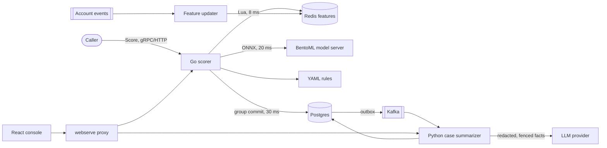
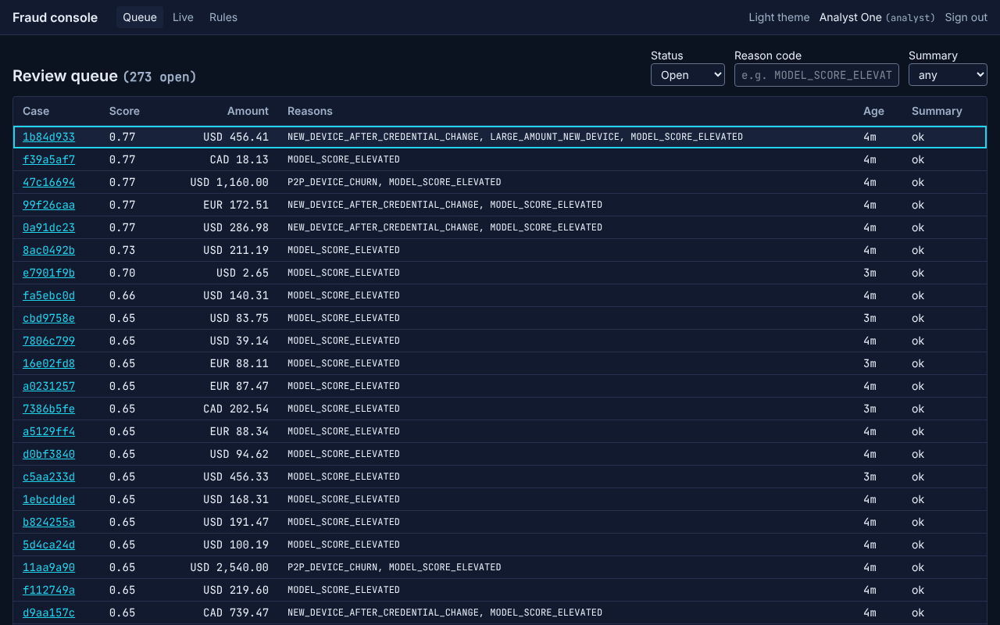
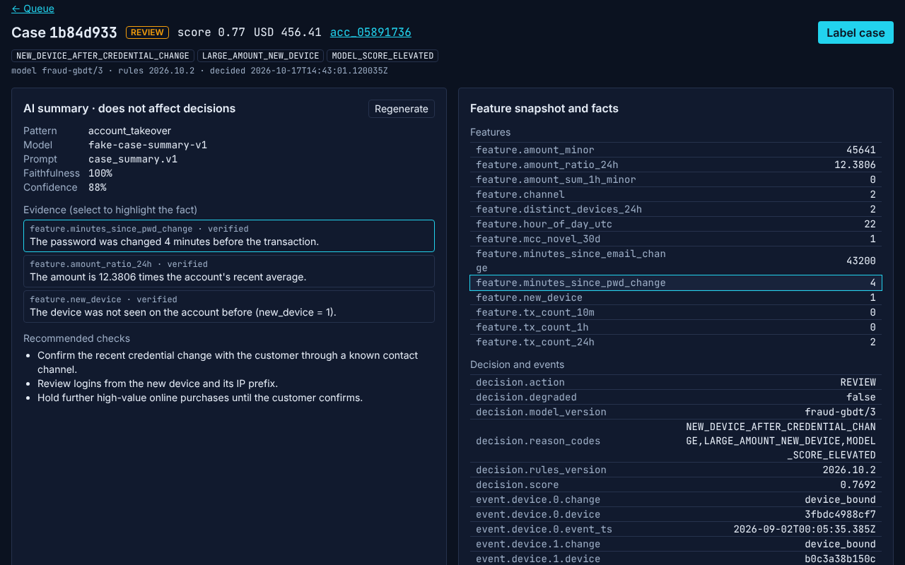

# fraud-scoring-service

Real-time card-fraud scoring. A Go gRPC scorer decides each transaction (APPROVE, REVIEW or DECLINE) from
point-in-time features in Redis, a calibrated gradient-boosted model served over ONNX, and versioned rules with
reason codes. A separate Python worker writes LLM case summaries for analysts, and is kept off the scoring path:
the LLM can never change, delay or block a decision. All data is synthetic.

> **Status.** Milestones M0 to M6 of the [build specification](docs/specs/000-build-spec.md) are done: scoring,
> features, model, rules, persistence, the case summarizer, the analyst console, evaluation, tracing and the
> security review. M7 to M9 are not started: the one-command compose stack, Terraform, CI, the scripted demo and
> chaos testing ([`PROGRESS.md`](PROGRESS.md)). The quick start below therefore runs the services on the host.

## What it does

- **Scores** a card transaction in a single gRPC (or HTTP) call within a 45 ms budget, and falls back to
  rules only when the model or Redis is slow, so every call still gets a decision.
- **Explains** each decision with reason codes from the rules and the model, and returns the feature values it
  scored on when the caller asks (`explain`).
- **Persists** every decision before answering, through a Postgres group-commit writer, a disk spool for
  outages and an outbox to Kafka; duplicate calls get the stored decision back.
- **Summarises** REVIEW cases for analysts with an LLM, after redacting PII and fencing third-party text; a
  faithfulness check drops any statement the facts do not support.
- **Shows** the queue, case detail, timeline, shadow-model comparison, live metrics and rules in a React
  console.
- **Audits** analyst actions in a keyed, hash-chained log with anchors held outside the database.

## Results

All numbers below are offline, on synthetic data (generator seed 7), as recorded in
[`evals/REPORT.md`](evals/REPORT.md) and [`PROGRESS.md`](PROGRESS.md). The eval suites ran at commit 2eba265;
`make eval` does not re-run the benchmarks, so the latency rows are from earlier runs, as noted.

| Area | Result | Source |
|---|---|---|
| Model + rules | recall 0.9161 at 0.79% false-positive rate on the temporal test split (gate: ≥ 0.80 at ≤ 1.5%) | [`evals/REPORT.md`](evals/REPORT.md), `make eval-model` |
| Shipped REVIEW threshold | recall 0.8387 at 0.32% false-positive rate | [`evals/REPORT.md`](evals/REPORT.md), `make eval-model` |
| Calibration | ECE 0.0007 (gate ≤ 0.02); PR-AUC 0.8740 | [`evals/REPORT.md`](evals/REPORT.md), `make eval-model` |
| Decisions | 90 of 90 golden test cases exact on action and reason codes | [`evals/REPORT.md`](evals/REPORT.md), `make eval-decisions` |
| Summaries | schema-valid 1.0, faithfulness 1.0, pattern accuracy 0.9028, PII to provider 0 (offline FakeLLM) | [`evals/REPORT.md`](evals/REPORT.md), `make eval-summary` |
| Score latency | p50 11.3 ms, p95 19.6 ms, p99 30.5 ms at 300 requests/s for 60 s (budget p95 80 ms; run of 2026-10-17 at f9ab2a5) | [`evals/REPORT.md`](evals/REPORT.md), `make bench` |
| Model server | p95 4.63 ms per prediction (measured on the first model version, fraud-gbdt/1) | [`PROGRESS.md`](PROGRESS.md) T-16, `make bench-model` |
| Rules engine | 14.9 µs per 64-rule evaluation | [`PROGRESS.md`](PROGRESS.md) T-19, `go test -bench BenchmarkEval64Rules ./internal/rules` |
| Tests | Go core coverage 86.4%, Python 93.11%, 662 pytest and 67 Vitest tests | [`PROGRESS.md`](PROGRESS.md) M6, `make test` |

Live LLM evals have not been run: there was no provider key in the build environment
([`evals/REPORT.md`](evals/REPORT.md)). How each suite works is in [`docs/evaluation.md`](docs/evaluation.md).

## Architecture



The scorer never waits on the summarizer or the LLM; summaries are written asynchronously for REVIEW
decisions only. The full design, the Score sequence and the degraded modes are in
[`docs/architecture.md`](docs/architecture.md); the reasoning behind each choice is in the ADRs in
[`docs/adr/`](docs/adr/README.md) and the answers in [`docs/design-faq.md`](docs/design-faq.md).

## Screenshots

Captured by the end-to-end suite (`E2E_SCREENSHOTS=1`, PROGRESS T-35) against the host stack.




More in [`docs/images/`](docs/images/): timeline (captured before the amount-display fix, so it shows
amounts 100 times too large; PROGRESS), shadow comparison, live metrics, rules, the label dialog and
the Grafana dashboard.

## Quick start

Requirements: Docker, plus the toolchains `make bootstrap` installs (Go, Python with uv, Node with pnpm; see
[`docs/DEVELOPMENT.md`](docs/DEVELOPMENT.md)). Everything runs offline; no API key is needed.

```bash
make bootstrap                                                # toolchains, dependencies, .env from .env.example
docker compose -f compose.test.yaml -p fraudtest up -d --wait  # Postgres, Redis, Redpanda on 85xx ports
make train                                                    # trains the model into artifacts/model
FULL=1 scripts/seed_host.sh                                   # services on the host, then a 72 h replay (the test split)
```

The console is then on <http://127.0.0.1:18500>; sign in by picking a synthetic persona from the dev issuer
(an analyst can label cases). The script's
header says how to stop the services. The one-command path (`make up`, `make seed`, then
<http://localhost:8500>) arrives with the compose stack in M7 (T-43).

To check the code without running the stack:

```bash
make check-fast   # lint and unit tests, under a minute
make test         # unit, integration and contract tests (starts the compose.test.yaml services)
make eval         # every eval suite and evals/REPORT.md
make security     # gitleaks, gosec, govulncheck, bandit, pip-audit, pnpm audit, hadolint, checkov, trivy
```

## Repository layout

| Path | What |
|---|---|
| `cmd/` | scorer, feature-updater, gen, replay, seed, dev-issuer, webserve, retention, benchreport, loadgen |
| `internal/` | API handlers and interceptors, features (Lua), model clients, rules, decisions, store, stream, auth, telemetry |
| `proto/`, `gen/` | protobuf sources; generated Go, gateway and OpenAPI |
| `training/`, `serving/` | dataset, offline features, training, ONNX export, evaluation, registry; BentoML and Triton |
| `src/fraud_summarizer/` | case summarizer: consumer, pipeline, redaction, faithfulness, LLM gateway |
| `prompts/`, `evals/` | versioned prompts; eval datasets, suites, graders and the report |
| `web/` | React + Vite analyst console |
| `migrations/`, `deploy/` | goose SQL migrations; OpenTelemetry, Prometheus and Grafana configuration |
| `tests/` | unit, integration, contract, end-to-end, harness and LLM tests |

## How it was built

A coding agent built this repository from the written specification, milestone by milestone, test first, with
subagent reviews at the end of each milestone and a security audit that took nine rounds. How the harness was
used, and the real mistakes made along the way, are in [`docs/ai-development.md`](docs/ai-development.md).
Every decision is recorded in [`docs/DECISIONS.md`](docs/DECISIONS.md).

## Documentation

| Document | Contents |
|---|---|
| [`docs/architecture.md`](docs/architecture.md) | Components, the Score path, degraded modes, data flow |
| [`docs/design-faq.md`](docs/design-faq.md) | Fifteen design questions answered with file references |
| [`docs/adr/`](docs/adr/README.md) | Architecture decision records |
| [`docs/evaluation.md`](docs/evaluation.md) | Eval suites, gates and current results |
| [`docs/security.md`](docs/security.md) | Threat model, controls, scan results, open findings |
| [`docs/runbook.md`](docs/runbook.md) | Alerts, audit verification, credentials, key rotation |
| [`docs/KNOWN_LIMITATIONS.md`](docs/KNOWN_LIMITATIONS.md) | What does not work, or works only partly |
| [`docs/verification.md`](docs/verification.md) | The latest verification run |
| [`docs/DEVELOPMENT.md`](docs/DEVELOPMENT.md) | Build environment and network notes |
| [`CONTRIBUTING.md`](CONTRIBUTING.md), [`SECURITY.md`](SECURITY.md), [`CHANGELOG.md`](CHANGELOG.md) | Contributing, reporting vulnerabilities, changes |

## Limitations

The main ones: offline evals only (no live LLM run), synthetic data only, govulncheck not run in the build
environment, and the M7 to M9 work listed above. The full list is in
[`docs/KNOWN_LIMITATIONS.md`](docs/KNOWN_LIMITATIONS.md) and the open security findings in
[`docs/security.md`](docs/security.md).

## License

[MIT](LICENSE). Part of an AI engineering portfolio by [@ROBERTG99](https://github.com/ROBERTG99).
