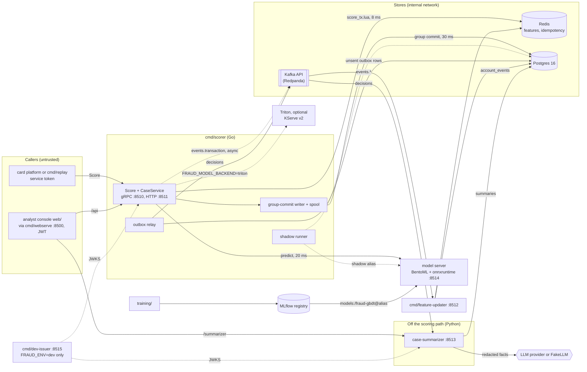
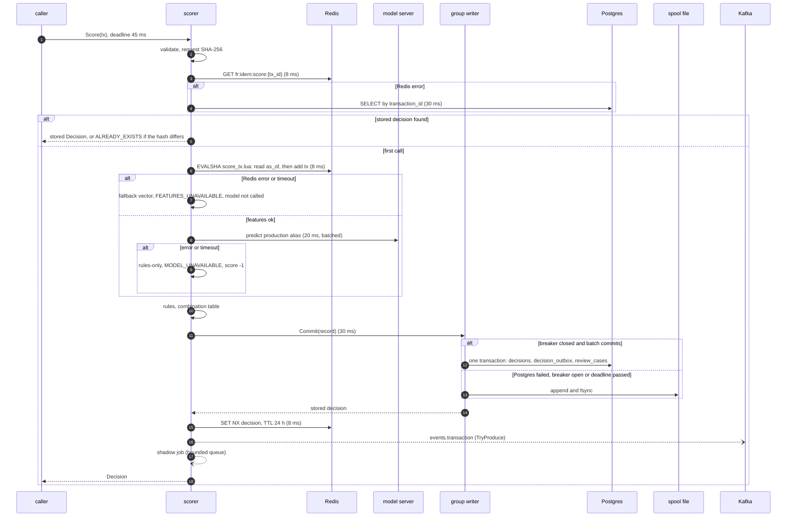
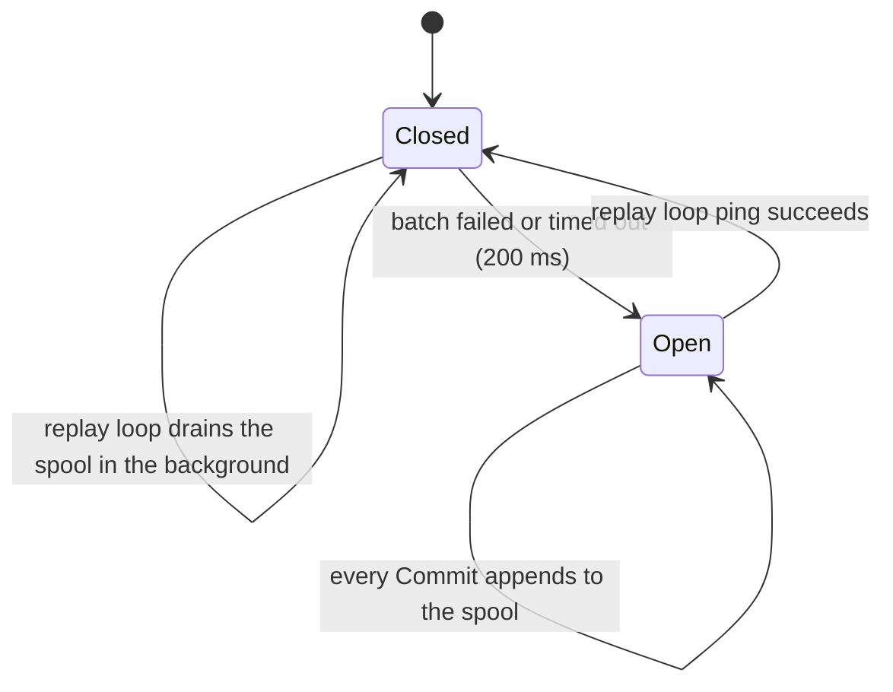
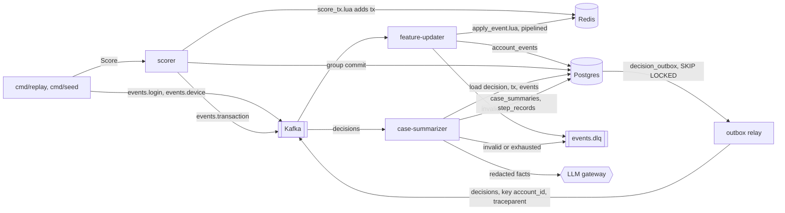
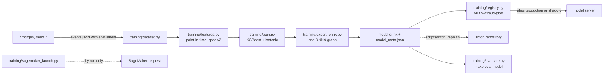

# Architecture

This page describes the fraud scoring service as the code stands at the end of milestone M6. The intended
design is in `docs/specs/000-build-spec.md` §4; where the code differs from the spec, this page follows the
code and names the decision row (`docs/DECISIONS.md`) that explains the difference. Architecture decisions
have records in `docs/adr/` (index: `docs/adr/README.md`). Every number below names the command or report
it came from.

## Status: what is built and what is not

Built and tested (M0 to M6, `PROGRESS.md` T-01 to T-42): the Go scorer with `CaseService`, the Redis Lua
feature store, the feature-updater, the BentoML model server and the KServe v2 client for Triton, the rules
engine and combination table, the Postgres group-commit writer with spool and outbox relay, the Python case
summarizer, the React analyst console, training with MLflow registration and a SageMaker dry-run launcher,
the offline eval suites, tracing, metrics and the observability compose profile.

Not built yet (M7 to M9, `PROGRESS.md` status `todo`):

- **T-43, images and the compose stack.** `compose.yaml` holds only the `scorer` and `case-summarizer`
  services and the `observability` and `datadog` profiles. Postgres, Redis, Redpanda, the model server, the
  feature-updater, MLflow, the dev-issuer, webserve, the `seed` job and the `triton` profile are not in it,
  and `Dockerfile.go` has a `scorer` target only. `make up`, `make seed`, `make triton-up`,
  `make audit-verify`, `make retention`, `make dlq-peek` and `make test-docker` address that stack and do not work until T-43 lands. Every
  measurement on this page comes from the host stack instead: `compose.test.yaml` (Postgres, Redis,
  Redpanda) plus processes started by `scripts/seed_host.sh`, `scripts/bench.sh` or `scripts/obs_host.sh`.
- **T-44, Terraform.** There is no `infra/terraform/`; `make tf-check` and `make lint-tf` fail.
- **T-45, CI.** There is no `.github/workflows/`.
- **T-48, durability and chaos.** `TestDurabilityKill` (NFR-7, "0 lost decisions when the scorer is killed
  under 1,000 RPS") does not exist, so the spool's crash behaviour is untested under load.
- T-47 (this documentation set), T-49 (final reviews) and T-50 (final verification) are also open.

## Components and trust boundaries

Solid arrows are on the request or main data path; dotted arrows are asynchronous, optional or
development-only. The scoring path calls only Redis, the model server and Postgres; Kafka is reached by a
non-blocking producer whose failure never reaches the caller.

| Component | Code | Default address | Role |
|---|---|---|---|
| scorer | `cmd/scorer`, `internal/api`, `internal/features`, `internal/model`, `internal/rules`, `internal/decide`, `internal/store` | gRPC `:8510`, HTTP gateway `:8511`, admin `127.0.0.1:8516` (`cmd/scorer/main.go:247-250`) | `fraud.v1.Scorer/Score`, `fraud.v1.CaseService`, the outbox relay, the shadow runner, rule hot reload |
| feature-updater | `cmd/feature-updater` | `127.0.0.1:8512` (D-060) | consumes `events.login`, `events.device`, `events.transaction`; applies them to Redis; writes `account_events`; invalid messages to `events.dlq` |
| model server | `serving/bentoml/service.py`, `serving/bentoml/runtime.py` | `:8514` (`FRAUD_MODEL_URL`) | `POST /predict` for aliases `production` and `shadow`, ONNX Runtime sessions, digest checks |
| Triton (optional) | `serving/triton/model_repository/`, `internal/model/triton.go` | `FRAUD_TRITON_URL` | the same ONNX graph over KServe v2; never run in this environment (`docs/KNOWN_LIMITATIONS.md`, "Serving") |
| case-summarizer | `src/fraud_summarizer/` | `:8513`, admin `127.0.0.1:8517` (D-054) | consumes `decisions`, writes `case_summaries`; `GET /v1/summaries/{case_id}`, `POST /v1/summaries/{case_id}:regenerate` |
| console | `web/`, `cmd/webserve` | `127.0.0.1:8500` | SPA; proxies `/api/` to the scorer gateway, `/summarizer/` to the summarizer and, in dev mode only, `/auth/` to the dev-issuer |
| dev-issuer | `cmd/dev-issuer` | `127.0.0.1:8515` | mints EdDSA JWTs for personas; starts only with `FRAUD_ENV=dev` (D-045) |
| training | `training/`, `cmd/gen` | none | synthetic data, offline features, XGBoost + isotonic calibration, ONNX export, MLflow registration, SageMaker dry run |
| replay and seed | `cmd/replay`, `cmd/seed`, `internal/replay` | none | the only producer of `events.login` and `events.device` in this repository; replays generated data through Kafka and `Score` |

Trust boundaries (full table and STRIDE analysis in `docs/security.md`):

- **Score callers** present a static service token, compared in constant time (`internal/api/interceptors.go:74-78`).
  Requests are capped at 64 KB (`internal/api/limits.go:10`) and validated field by field, with currency and
  MCC allowlists (`internal/api/validate.go:38`, D-051); `event_ts` must fall within
  [now − 24 h, now + 5 min] (`internal/api/limits.go:20-23`, D-041). The service principal is not rate
  limited, because the writer queue already sheds load (D-021).
- **Console users** present an EdDSA JWT from the issuer's JWKS (`internal/auth/jwt.go`,
  `src/fraud_summarizer/auth.py`). RBAC is a deny-by-default table (`internal/auth/rbac.go`): `LabelCase` for
  analysts, `TestRule` for risk engineers, `GetShadowSummary` for risk or ML engineers, reads for any console
  role. Each user gets 20 requests per second on both services (D-021, D-054).
- **The LLM provider** is a third party. Only `src/fraud_summarizer/llm/` imports a provider SDK
  (`anthropic_adapter.py`, `openai_adapter.py`); `go.mod` contains none. Facts are redacted before they leave
  the process and output is schema-checked and verified by code before it is stored.
- **Internal stores** are separated by Postgres role: `fraud_app` (scorer, relay, console APIs) can insert but never update or delete
  decisions and labels, and `fraud_summarizer` can read decisions but write only its own tables
  (`migrations/00007_service_roles.sql`, D-043, `TestServiceRolesAreLeastPrivilege`). Redis clients send
  ACL credentials when set, but no ACL is defined yet (open finding in `docs/security.md`). Kafka and the
  model server rely on network isolation.

## The Score request path

`ScorerServer.Score` (`internal/api/scorer.go:119-274`) runs these steps in order. The step budgets are the
constants at `internal/api/scorer.go:33-38`. Each step's context is derived from the 45 ms Score context, so
a step that starts late gets whatever remains of the 45 ms, not its full budget.

| Budget | Value | Applies to |
|---|---|---|
| `ScoreTimeout` | 45 ms | the whole handler after validation |
| `RedisTimeout` | 8 ms | idempotency `GET`, `score_tx.lua`, idempotency `SET NX` |
| `ModelTimeout` | 20 ms | one `Predict` on the `production` alias |
| `PostgresTimeout` | 30 ms | the group commit, and the idempotency lookup when Redis errors |

1. **Interceptors.** The gRPC server (and the HTTP gateway in front of it) enforces message, header and stream
   limits (D-046), authenticates the caller and recovers panics (`internal/api/interceptors.go`).
2. **Validate.** `ValidateTransaction` checks every field before any I/O (`internal/api/scorer.go:121`); a
   failure is `INVALID_ARGUMENT` with field violations.
3. **Deadline and span.** The 45 ms context and the `fraud.score` span start (`internal/api/scorer.go:124-128`).
4. **Idempotency lookup.** The request's SHA-256 is computed over its deterministic protobuf encoding
   (`RequestHash`, `internal/api/scorer.go:322`). `lookup` reads `fr:idem:score:{transaction_id}` from Redis
   within 8 ms; a value whose `fidem2` prefix or HMAC does not verify is a miss and is deleted
   (`internal/store/idempotency.go:58-79`, D-057, D-062). Only when Redis errors does `lookup` ask Postgres by
   `transaction_id` within 30 ms (`internal/api/scorer.go:341-361`, D-017). A hit with the same request hash
   returns the stored decision; a hit with a different hash answers `ALREADY_EXISTS` (D-044).
5. **Event time.** `event_ts` outside the accepted window answers `INVALID_ARGUMENT` before Redis is touched
   (`internal/api/scorer.go:140-147`, `:277-289`).
6. **Features.** One `EVALSHA` of `internal/features/score_tx.lua` within 8 ms (`internal/api/scorer.go:152-161`,
   `internal/features/store.go:121-153`). The script reads the account's five keys strictly before `as_of`
   (`score_tx.lua:28-48`) and then adds the transaction (`score_tx.lua:50-67`) in the same atomic call, so
   nothing interleaves between read and write (`TestReadAsOfThenAddIsAtomic`; ADR 0009). On any error the
   scorer builds `FallbackVector` (`internal/features/fallback.go:13-23`) and counts
   `fraud_degraded_total{reason="features"}`.
7. **Model.** Only when features succeeded (D-013), `Predict` on the `production` alias within 20 ms
   (`internal/api/scorer.go:163-180`). The client is the per-alias `Batcher` (`internal/model/batcher.go:21-25`,
   D-024) over `BentoML` or `Triton` (`cmd/scorer/main.go:103-111`, `:186`). On error or timeout the score
   stays −1, `model_version` stays `"none"` and `fraud_degraded_total{reason="model"}` is counted.
8. **Rules and combination.** The active rule set evaluates the typed feature environment, and
   `decide.Combine` applies the threshold table (`internal/api/scorer.go:182-190`,
   `internal/decide/combine.go:56-134`; ADR 0008).
9. **Build the record.** A UUIDv7 `decision_id`, the reason codes, versions and `degraded` flag; the record
   also carries the request attributes for `decisions.tx` (D-019), the `events.transaction` payload, the
   request hash and the span's W3C `traceparent` (`internal/api/scorer.go:192-211`, D-038).
10. **Persist before responding.** `Decisions.Commit` within 30 ms (`internal/api/scorer.go:213-228`): the
    group-commit writer (below) either commits the batch to Postgres or spools the decision to disk, and only
    then returns. `ErrOverloaded` becomes `RESOURCE_EXHAUSTED`; any other error means even the spool failed
    and becomes `UNAVAILABLE`.
11. **Conflict path.** If the stored decision is not this one (a concurrent duplicate won `ON CONFLICT`, or the
    Redis value had expired), the stored decision is written back to Redis, the hash check runs, and the
    stored decision is returned (`internal/api/scorer.go:229-248`, D-057, D-064).
12. **Cache.** `SET NX` of the MACed decision with a 24 h TTL within 8 ms (`internal/api/scorer.go:250-254`,
    `internal/store/idempotency.go:82-93`); a failure is logged at debug level and ignored.
13. **Asynchronous work.** `PublishTransaction` uses franz-go `TryProduce`, which fails at once when the buffer
    of 100,000 records is full and counts `fraud_publish_dropped_total` (`cmd/scorer/publisher.go:17-27`,
    `cmd/scorer/main.go:166`). The shadow job is offered to a bounded queue (`internal/api/scorer.go:259-262`).
14. **Respond.** Metrics, the live-metrics window and, with `explain = true`, the feature map
    (`internal/api/scorer.go:264-273`).

Measured on the host stack: `make bench` (ci profile, 300 rps for 60 s) gives p50 11.3 ms, p95 19.6 ms and
p99 30.5 ms, with 169 of 17,999 decisions degraded (`evals/REPORT.md`, latency). The laptop profile
(2,000 rps) fails in the 4-vCPU build container: 586 rps achieved, p95 603.8 ms (`PROGRESS.md` T-39,
`docs/KNOWN_LIMITATIONS.md`). With tracing off, `BenchmarkScore` makes 79 allocations per call
(`go test -run xxx -bench BenchmarkScore -benchmem -count 3 ./internal/api`, D-056).

### Combination table

`decide.Combine` (`internal/decide/combine.go:56-134`) implements spec §4.4:

- severity is APPROVE < REVIEW < DECLINE;
- a matched `final` rule decides (the most severe one if several match);
- otherwise the action is the maximum of the matched rules' actions and the model band
  (`thresholds.review` 0.30, `thresholds.decline` 0.85 in `rules/rules.v2026.10.2.yaml`);
- when degraded, the model band is replaced by REVIEW if `amount_minor` is at least the floor
  (`model_unavailable` 20,000, `features_unavailable` 5,000) and APPROVE otherwise;
- reason codes are ordered: the final rule, other rules by ID, the model code, then degradation codes.

The engine loads the highest-versioned `rules/rules.v*.yaml` (`internal/rules/engine.go:46-56`), refuses a
set pinned to another feature spec at startup and on reload (`cmd/scorer/main.go:136-140`, ADR 0001), polls
the directory every 5 s and reloads on the Redis channel `fr:rules:changed` (`cmd/scorer/main.go:210`). An
invalid file never replaces the active set (`TestInvalidExprKeepsPreviousVersion`), and a rule that errors at
runtime is a non-match counted in `fraud_rule_errors_total` (D-016). Each loaded set is recorded in
`rule_sets`.

## Degraded modes

| Dependency | Behaviour | Signal | Evidence |
|---|---|---|---|
| Model server slow or down | rules-only: score −1, `model_version = "none"`, `MODEL_UNAVAILABLE`, `degraded = true`, band by amount (floor 20,000) | `fraud_degraded_total{reason="model"}` | `TestModelTimeoutRulesOnlyWithin35ms` (50 ms stub, answer under 35 ms) |
| Redis slow or down | fallback vector, model not called (D-013), `FEATURES_UNAVAILABLE`, band by amount (floor 5,000); idempotency through Postgres (D-017) | `fraud_degraded_total{reason="features"}` | `TestRedisDownBiasesToReview` |
| Postgres slow or down | decision spooled to disk and returned; breaker sends every later commit to the spool until a ping succeeds (D-027) | `fraud_writer_degraded`, `fraud_spool_depth` | `TestSpoolReplayAfterPostgresRecovers`, `TestHungPostgresSpoolsInsteadOfOverloading`, `TestBreakerClosesUnderContinuousTraffic` |
| Writer queue full for 5 ms | `RESOURCE_EXHAUSTED` | gRPC status | `internal/store/writer.go:149-163` |
| Kafka down | `decision_outbox` rows stay unsent; `events.transaction` records beyond the producer buffer are dropped | `fraud_outbox_unsent`, `fraud_outbox_oldest_unsent_age_seconds`, `fraud_publish_dropped_total` | a failed produce only counts an attempt and leaves the rows unsent (`internal/store/outbox.go:89-93`) |
| LLM provider | retries, optional fallback provider, then a templated `fallback` summary; the decision is unaffected | `fraud_summary_status_total{status}` | `test_provider_failure_writes_fallback` |
| MLflow | the model server uses its cached artifact, else the alias is not ready and the scorer degrades to rules-only | model server `/readyz` | `serving/bentoml/runtime.py:1-13` |
| Invalid rule file | the previous rule set stays active | log line | `TestInvalidExprKeepsPreviousVersion` |

### Rules-only fallback

When Redis fails, the vector is the training p90 defaults from `features/spec.yaml` plus what the request
itself carries: amount, channel, hour of day, and an amount ratio of 1 (`internal/features/fallback.go:13-23`).
The scorer does not call the model on that vector (D-013), and it passes `ModelOK: modelOK || !featuresOK` to
the combination (`internal/api/scorer.go:186`), so a Redis outage reports `FEATURES_UNAVAILABLE` alone. The
"both unavailable" branch of `Combine`, which takes the lower floor and both codes (D-012), is exercised by
its unit tests only: `internal/api/scorer.go:186` is the one production caller, and the eval harness
`cmd/evaldecide` drives the same `ScorerServer`. Rules still run in either case, so a request-only rule such
as R009 (`mcc in ['7995']`) still declines.

### Spool and breaker

The group writer (`internal/store/writer.go`) batches commits: up to 256 records or every 2 ms from a
10,000-slot queue, one transaction per batch writing `decisions`, `decision_outbox` and, for REVIEW, a
`review_cases` row through one CTE per record (`internal/store/writer.go:265-279`). Every insert is
`ON CONFLICT DO NOTHING`, so replaying a record is a no-op; conflicting rows are read back in the same
transaction and returned with their request hash (`internal/store/writer.go:326-348`).

`Commit` (`internal/store/writer.go:141-173`) spools when the breaker is open, when its own deadline passes
while it waits (the flusher then skips the abandoned entry), or when the whole batch fails. The spool
(`internal/store/spool.go`) is a JSONL file that is fsynced on every append (`spool.go:82-109`); in breaker
mode each commit fsyncs on its own (D-027). The replay loop (`internal/store/writer.go:408-450`) runs every
second: while the breaker is open it pings Postgres, closes the breaker on the first success, then rotates the
active file and replays it through the same idempotent batch insert.

The spool lives on the scorer's local disk (the compose volume `scorer-spool`), so a decision in it is durable
only as long as that disk is. A replay with other contents that arrives while Redis has no value and Postgres
is down is spooled as a new decision and answered with it; the spool replay later keeps the first decision
(`docs/security.md`, STRIDE for the scorer). A shadow comparison for a decision still in the spool fails the
`shadow_comparisons` foreign key and is counted as failed. NFR-7 (kill under load, nothing lost) is T-48 and
not tested.

## Data flow

Topics are created with 12 partitions (`internal/stream/kafka.go:15`), keyed by `account_id`, with JSON
values validated against `schemas/events/` in Go (`internal/stream/validate.go`) and Python
(`src/fraud_summarizer/events.py`).

| Topic | Producer | Consumer |
|---|---|---|
| `events.login`, `events.device` | `internal/replay` | feature-updater |
| `events.transaction` | scorer (`cmd/scorer/publisher.go`), warm-up phase of `internal/replay` | feature-updater |
| `decisions` | outbox relay (`internal/store/outbox.go`) | case-summarizer |
| `events.dlq` | feature-updater, case-summarizer | `rpk topic consume events.dlq` (`make dlq-peek` waits on T-43) |

### Events to features

The feature-updater (`cmd/feature-updater/updater.go:82-140`) runs one goroutine per partition
(`internal/stream/consumer.go:30`). For each batch it validates every record, produces invalid ones to
`events.dlq` (once, even when the batch is retried), applies the valid ones to Redis in pipelined
`apply_event.lua` calls within 2 s, hands them to the `account_events` writer, and only then commits the
offsets. `apply_event.lua` is idempotent: ZSET members are unique, sightings use `ZADD GT` (last seen) and
`ZADD LT` (first seen, ADR 0001). The updater's `ZADD` of a transaction the scorer already added is a no-op
(ADR 0009). Measured: `BenchmarkUpdater` applies 57,359 events/s (`PROGRESS.md` T-12). `account_events` rows
are written in batches and dropped, with a counter, when the queue is full or an insert fails
(`docs/KNOWN_LIMITATIONS.md`, "Features").

The replay feeds history through Kafka and waits for the updater, then applies each live login or device event
itself on the worker that scores that account, so no transaction sees a later event (`internal/replay/replay.go:1-15`,
D-025, `TestReplayDoesNotLeakLaterEventsIntoFeatures`).

Online and offline features agree: `make feature-parity` compares the Go path with `training/features.py` on
3,502 transactions × 13 features with 0 mismatches (`PROGRESS.md` T-13).

### Decisions to summaries

1. The group commit writes the decision, its outbox row (payload `fraud.decision.v1`,
   `internal/store/decision.go:60-73`, plus the `traceparent`) and, for REVIEW, an open case.
2. The relay in each scorer process (`cmd/scorer/main.go:208-209`) polls every 100 ms. `RunOnce`
   (`internal/store/outbox.go:47-106`) locks up to 500 unsent rows with `FOR UPDATE SKIP LOCKED`, produces
   them synchronously with the `traceparent` header, and marks them sent in the same transaction. A crash
   between producing and committing re-sends the rows with the same `decision_id`
   (`TestRelayCrashProducesDuplicatesWithSameDecisionID`).
3. The summarizer (`src/fraud_summarizer/consumer.py:157-273`) consumes `decisions` in group
   `case-summarizer` with manual commits, partitions concurrently and messages in order. `DecisionHandler`
   (`consumer.py:102-126`) skips non-REVIEW decisions and decisions already in `processed_messages`, records
   a paid attempt in `summary_attempts` just before the provider call (at most 3 per decision, D-048), runs the
   pipeline, and marks the decision processed only after the summary is stored (D-022).
4. `SummaryPipeline.run` (`src/fraud_summarizer/pipeline.py:206-398`) is a fixed pipeline, not an agent:
   `load_facts` → `redact` → `summarize` → `validate_schema` → `check_faithfulness` → `persist`, one
   `step_records` row each. Facts are flat keys built from the decision, `decisions.tx`, the features and up to
   49 earlier `account_events` (`build_facts`, `pipeline.py:104`). `redact_text`
   (`src/fraud_summarizer/redact.py:627`) removes e-mail addresses, phone numbers and card-like numbers before
   any provider call. The gateway route `case_summary` (`config/llm_routes.yaml`) has an 8 s timeout and
   3 attempts per provider, retries only retryable errors (D-014) and stops paying once the daily budget is
   spent (D-048). Faithfulness keeps an evidence item only when its `fact_key` exists and its statement
   matches the fact's value (`src/fraud_summarizer/faithfulness.py:147-188`); with nothing kept the status is
   `unfaithful`. A spent gateway or a schema failure stores a templated `fallback` summary.
5. Failures: an invalid message or a decision that used its paid attempts goes to `events.dlq`; a transient
   failure commits the processed prefix, seeks back and retries with backoff from 1 s to 30 s; five
   non-transient failures send the message to the DLQ (`consumer.py:208-264`, D-048).

Offline (`make eval-summary`, FakeLLM, 72 test cases): schema validity 1.0, faithfulness 1.0, pattern accuracy
0.9028, PII to provider 0, p95 50.5 ms (`evals/REPORT.md`). Live evals have not run: there is no provider key in
this environment (`evals/REPORT.md`).

## Persistence

Schema: goose migrations `migrations/00001_roles.sql` to `migrations/00013_audit_seq_positive.sql`, embedded in
the scorer binary and applied by `scorer migrate` with the owner role.

| Table | Written by | Notes |
|---|---|---|
| `decisions` | scorer (insert only) | `transaction_id` UNIQUE; `features` and `tx` (D-019) are jsonb, `request_sha256` (D-044) is bytea |
| `decision_outbox` | scorer (insert), relay (mark sent) | `traceparent` (D-038); indexed on unsent rows and on `decision_id` (D-056) |
| `review_cases` | scorer (insert with the decision), `LabelCase` (status) | one per REVIEW decision; priority is the score, or a bounded function of the amount when degraded (`internal/store/decision.go:84-90`) |
| `case_summaries` | summarizer | `ON CONFLICT DO NOTHING`; regenerate replaces |
| `step_records`, `processed_messages`, `summary_attempts`, `summary_regenerations` | summarizer | pipeline steps; once-only processing; paid attempts (D-048); regenerate requests and their idempotency keys (D-054) |
| `analyst_labels` | `LabelCase` | `case_id` and `idempotency_key` UNIQUE |
| `audit_log` | `LabelCase` | append-only by trigger, keyed hash chain (below) |
| `shadow_comparisons` | shadow runner | one per compared decision |
| `rule_sets` | scorer on every rule load | one active row |
| `account_events` | feature-updater | best-effort timeline for the console and the summarizer (D-005) |
| `model_versions` | nothing yet | the table and grants exist (`migrations/00002_decisions.sql:85`), but no code writes it; the registry of record is MLflow |

Retention (`cmd/retention`, `internal/store/retention.go`; `make retention` waits on T-43) deletes by age in batches:
decisions and everything that cascades from them after 400 days, published outbox rows after 7 days, step
records and processed messages after 90 days, account events after 400 days. It never deletes from
`audit_log` (D-040, `TestRetentionDeletesOnlyExpiredRows`).

## Idempotency

| Key | Where | Effect |
|---|---|---|
| `transaction_id` | Redis `fr:idem:score:{transaction_id}` (`SET NX`, 24 h, HMAC under a key derived from `FRAUD_AUDIT_KEY`), and `decisions.transaction_id` UNIQUE | a replay returns the first decision; a replay with other contents answers `ALREADY_EXISTS` / HTTP 409 (D-017, D-044, D-062; `TestScoreReplayReturnsSameDecisionID`, `TestReplayWithDifferentContentsIsRejected`) |
| `event_id` | the ZSET member in `fr:{acc}:tx` | the updater's re-application of a scored transaction changes nothing |
| `decision_id` | `processed_messages` (consumer `case-summarizer`) | duplicates from the at-least-once relay are skipped (`test_duplicate_decision_processed_once`) |
| label `idempotency_key` | `analyst_labels` UNIQUE | a retried label does not write twice |
| regenerate `Idempotency-Key` | `summary_regenerations`, scoped to the case | a retried regenerate is a duplicate; a refused one records nothing (D-054) |

Two gaps are documented in `docs/KNOWN_LIMITATIONS.md`: a replay whose Redis value is lost runs
`score_tx.lua` again before Postgres reports the conflict, so a replay with other contents adds its feature
event even though it is then refused ("A replay after a lost idempotency value adds one feature event"); and
demo and eval data share transaction ids, so loading both into one stack breaks transaction-id idempotency.

## Shadow mode

With `FRAUD_SHADOW_ENABLED` (default `true`, `cmd/scorer/main.go:216-223`), the scorer offers every decision
whose features and primary model succeeded to a `ShadowRunner` (`internal/model/shadow.go`): 16 workers, a
2,000-job queue and a 100 ms timeout per job (`shadow.go:54-66`). `Submit` never blocks; a full queue drops the
job and counts `fraud_shadow_dropped_total` (`shadow.go:76-86`). A worker scores the `shadow` alias through
the same per-alias batcher, maps both scores to bands under the active thresholds and stores a
`shadow_comparisons` row (`shadow.go:109-136`). The console's shadow screen reads them through
`GetShadowSummary`.

Isolation is by construction: the job is submitted after the response is built and nothing it returns is read
by `Score`. `TestShadowFailureDoesNotChangeDecisions` scores 1,000 transactions with an always-failing shadow
and gets the same decisions as without one. The shadow alias does share the model server's CPU with
production; one HTTP call per row saturated BentoML once shadow doubled the load, which the batcher fixed
(D-024).

## Audit chain

`LabelCase` writes the label, closes the case and appends one `audit_log` row in a single transaction
(`internal/store/cases.go:302-356`). It is the only writer of `audit_log` today. `AppendAudit`
(`internal/store/audit.go:95-125`) takes an advisory lock, reads the head, and stores an HMAC-SHA256 over the
length-prefixed fields and the previous hash, under `FRAUD_AUDIT_KEY`, which lives outside the database
(`alg = 2`, D-050). A trigger rejects UPDATE and DELETE (`migrations/00003_audit_log.sql`), and `seq` must be at
least 1 (`migrations/00013_audit_seq_positive.sql`, D-061).

`scorer audit-anchor` verifies the chain and appends its signed head to `FRAUD_AUDIT_ANCHORS`, a file outside
the database whose entries are chained to each other; `scorer audit-verify` recomputes the chain and checks
every anchor (`internal/store/audit.go:194`, `cmd/scorer/audit.go`, D-057). Outside dev mode the scorer refuses
to start without the key and `audit-verify` refuses to run without anchors. Tests: `TestAuditChainIsKeyed`,
`TestAuditAnchorsDetectTruncation`, `TestLabelWritesAuditRow`. What the chain does not protect against (a
compromised scorer, which holds the key; a table owner or superuser who disables the triggers; entries after
the last anchor) is in `docs/KNOWN_LIMITATIONS.md`, "Audit log trust boundary". `make audit-verify` runs the command inside the compose scorer, which needs the T-43 stack.

## Observability

- **Metrics.** The Go services register `fraud_score_latency_seconds`, `fraud_decisions_total{action}`,
  `fraud_degraded_total{reason}`, `fraud_updater_lag_seconds`, `fraud_spool_depth`, `fraud_writer_degraded`,
  `fraud_outbox_unsent`, `fraud_outbox_oldest_unsent_age_seconds`, `fraud_shadow_dropped_total`,
  `fraud_publish_dropped_total`, `fraud_rule_errors_total` and others (`internal/telemetry/metrics.go:20-69`).
  The summarizer adds `fraud_summary_status_total`, `fraud_llm_cost_usd_total`, `fraud_llm_calls_total` and
  `fraud_summarizer_messages_total` (`src/fraud_summarizer/metrics.py`). Metrics and the detailed `/readyz`
  are served only on the admin listeners (D-052, D-054).
- **Alerts.** `ScoreLatencyHigh` (p95 over 50 ms for 5 min), `DegradedDecisions` (over 1% of decisions
  degraded over 10 min) and `OutboxUnsentAge` (oldest unsent row over 60 s) in
  `deploy/prometheus/alerts.yml`, with unit tests that pin each threshold from both sides
  (`deploy/prometheus/alerts_test.yml`, D-056; `make obs-check`). Each alert has a runbook entry in
  `docs/runbook.md`.
- **Traces.** Exported only when `OTEL_EXPORTER_OTLP_ENDPOINT` is set (`internal/telemetry/tracing.go:36`,
  D-038). `fraud.score` has children `features.score_tx`, `model.predict`, `rules.evaluate` and
  `postgres.commit`. The traceparent is stored with the outbox row and the spool and sent as a Kafka header,
  so the summarizer's `summarizer.decision` span and one `summarizer.<node>` span per step join the Score
  trace even when published later. Span attributes carry decision ids, action, score and versions, never
  account, device or merchant ids. On the host stack, 29 of 29 sampled summarized decisions traced from
  `fraud.v1.Scorer/Score` through `summarizer.persist` (`scripts/obs_host.sh`, `scripts/obs_verify.py`,
  `PROGRESS.md` T-41).
- **Logs.** JSON with `trace_id` and `span_id` (`internal/telemetry/logging.go`,
  `src/fraud_summarizer/telemetry.py`).
- **Dashboards.** `deploy/grafana/fraud.json` is generated by `scripts/gen_dashboard.py` and tested against the
  registered metric names; the `observability` compose profile runs the collector, Prometheus, Grafana and
  Jaeger, and the `datadog` profile adds a Datadog exporter.

## Training and registry

1. **Data.** `cmd/gen` writes 24 days of synthetic events: 4 warm-up days, then a 70/15/15 temporal split by
   day into train, valid and test (`cmd/gen/generator.go:75`, `:749-764`). Demo size is 200,000 events
   (`PROGRESS.md` T-08); eval size 2,000,000 (`PROGRESS.md` T-37).
2. **Features.** `training/features.py` computes the 13 features of `features/spec.yaml` as of each
   transaction, using only earlier events, the same definitions as `score_tx.lua` (parity above).
3. **Model.** An XGBoost classifier (`XGBClassifier`, 300 trees, depth 6, `tree_method: hist`,
   `training/train.py:32-43`), with scikit-learn `HistGradientBoostingClassifier` as a fallback when xgboost
   cannot be imported (`training/train.py:86-101`); the wheel is `xgboost-cpu` (D-003). Isotonic calibration is
   fit on the valid split and post-processed to a slope of at most 10 (`training/train.py:107-142`, D-008).
4. **Export.** The trees and the calibration map become one ONNX graph (`training/export_onnx.py:87-106`), so
   every runtime returns the calibrated probability. Training refuses an export that differs from the native
   model by more than 1e-5 (`training/train.py:213-220`); on demo data the maximum difference is 7.14e-06
   (`PROGRESS.md` T-14). `model_meta.json` records the feature spec, the ONNX SHA-256, metrics and a golden
   vector.
5. **Registry.** `registry.log_and_register` logs the run and registers a `fraud-gbdt` version tagged with
   headline test metrics, the backend and `onnx_sha256` (`training/registry.py:55-86`); locally MLflow uses a
   SQLite backend (D-009). `make register-model ALIAS=production|shadow` sets an alias.
6. **Serving.** For each alias the model server loads `models:/fraud-gbdt@<alias>`, else its cached copy, else
   `FRAUD_MODEL_DIR` (`serving/bentoml/runtime.py:1-13`). It refuses bytes that do not match every recorded
   digest, a model with no recorded digest, and, outside dev mode, a local or cached model without a pinned
   `FRAUD_MODEL_SHA256_<ALIAS>` (D-047, D-059, D-063); it refuses a model built for another feature spec (ADR
   0001). The service is ready only when `production` is loaded (`runtime.py:190-191`). Measured single-row
   latency: p95 4.63 ms over 2,000 requests (`make bench-model`, `PROGRESS.md` T-16).
7. **Evaluation.** `make eval-model` scores the 169,604-transaction test split of the eval data through the
   serving artifact and the Go rule engine: recall 0.9161 at FPR 0.79% at the threshold chosen on valid, and
   0.8387 at FPR 0.32% at the shipped review threshold 0.30; PR-AUC 0.8740, ECE 0.0007 (`evals/REPORT.md`,
   D-033, D-037).
8. **Cloud training.** `make sagemaker-dry-run` prints a `CreateTrainingJob` request validated against
   botocore's service model, with no credentials (`training/sagemaker_launch.py`, `PROGRESS.md` T-30). The
   Terraform module that would create its role, bucket and repository is T-44 and not built. No make target
   submits a job (`--submit` exists but is never run by a target) or applies Terraform.

All metrics are on synthetic data whose patterns were designed to be learnable from these features; they say
nothing about production fraud (`docs/KNOWN_LIMITATIONS.md`, "Data and model").
