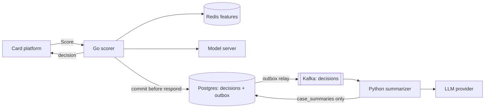

# Design FAQ

Answers to the fifteen questions of spec §18, in the spec's order, with `path:line` references into this
repository and decision numbers from `docs/DECISIONS.md`. Status at the time of writing: milestones M0 to M6
are done (`PROGRESS.md`, session handoff); M7 to M9 are not. The compose stack (T-43), Terraform (T-44), CI
(T-45), the demo (T-46) and the durability and chaos tests (T-48) are still `todo` (`PROGRESS.md:185-190`).
The documentation set (T-47), this page included, is being written ahead of M7 (D-070). ADR 0001 holds the
feature-spec v2 decision, so the eight ADRs of spec §18 are numbered 0002 to 0009 (D-070). All data is
synthetic (`cmd/gen`, seed 7), and every number below names the command or report it comes from.

## 1. Why Go for scoring?

The spec picks Go for the scorer and the feature-updater for "low tail latency", with Python as the rejected
alternative (`docs/specs/000-build-spec.md:452`). In this code that means every dependency call carries its
own in-process deadline (`internal/api/scorer.go:33-38`), and the background work that shares the process runs
on goroutines owned by the server: the group-commit writer, the shadow pool and the model batcher
(`cmd/scorer/main.go:181-221`). The measured pieces are small: one Score with in-memory dependencies costs 79
allocations with tracing off (D-056, `go test -run xxx -bench BenchmarkScore -benchmem ./internal/api`), a
64-rule evaluation takes 14.9 µs (`go test -bench BenchmarkEval64Rules ./internal/rules`, `PROGRESS.md:161`),
and the feature-updater applies 57,359 events/s (`BenchmarkUpdater`, `PROGRESS.md:154`). No Python scorer was
built, so no Go-versus-Python comparison was measured. The Python component on the path, the BentoML model
server, is the throughput limit on a shared 4-CPU host (`docs/KNOWN_LIMITATIONS.md:59-66`).

## 2. How is point-in-time correctness guaranteed?

The scorer computes features as of the transaction's own `event_ts` (`internal/api/scorer.go:140-147`), which
must fall within [now − 24 h, now + 5 min] so that a caller cannot rewrite an account's history (D-041,
`internal/api/scorer.go:276-289`). `score_tx.lua` reads every window with an exclusive upper bound `(as_of`
(`internal/features/score_tx.lua:6-13`), takes credential changes strictly before `as_of` (lines 36-48), and
only then adds the transaction (lines 50-67). Both steps run in one script call, so nothing can interleave
between the read and the add (lines 1-2). `TestReadAsOfThenAddIsAtomic` (`internal/features/redis_test.go:44`)
checks this with 64 concurrent writers and one round trip per score (`PROGRESS.md:153`), and
`TestOutOfOrderWithinFiveMinutes` (`internal/features/redis_test.go:113`) checks late arrivals. One known gap:
device and MCC sets keep only the latest sighting (`ZADD GT`, `score_tx.lua:54`, `:64`), so an event that
arrives before an earlier transaction is scored can make a device or MCC look unseen
(`docs/KNOWN_LIMITATIONS.md:7-11`).

## 3. How is train/serve skew prevented?

There is one feature definition, `features/spec.yaml`. Go embeds it (`features/embed.go:8-9`) and Python
loads it (`training/features.py:21`, `:36-39`), and both refuse any version other than `v2`
(`internal/features/spec.go:82`). The model records the spec it was trained on, and the model server refuses
a model trained for another spec (`serving/bentoml/runtime.py:93-106`). The scorer refuses a rule set
written for another spec, at start and on hot reload (`cmd/scorer/main.go:136-140`). `make feature-parity`
compares the Go online path with `training/features.py` on 3,502 transactions × 13 features and finds 0
mismatches (`tests/integration/parity_test.go:55`, `PROGRESS.md:155`). The calibration map is part of the
ONNX graph (`training/export_onnx.py:1-5`, D-008), and training fails if ONNX and the native model differ by
more than 1e-5 (`training/train.py:215-220`; 7.14e-06 on demo data, `PROGRESS.md:156`). Gaps: ONNX parity is
checked on demo data only, and device features can differ after a 90-day gap
(`docs/KNOWN_LIMITATIONS.md:44-46`, `:89-96`).

## 4. What happens on model timeout?

The model call gets 20 ms (`internal/api/scorer.go:36`, `:167`), and the client wraps every failure, timeout
included, in `ErrUnavailable` (`internal/model/client.go:18-31`, `internal/model/bentoml.go:44-62`). The
decision is then rules-only: score −1, `model_version` `none`, reason `MODEL_UNAVAILABLE`, `degraded=true`
(`internal/api/scorer.go:163-180`). The model band is replaced by an amount floor: REVIEW from 20,000 minor
units, APPROVE below (`internal/decide/combine.go:56-75`, `rules/rules.v2026.10.2.yaml:11`). Rules still fire,
and a final rule still wins (`internal/api/degrade_test.go:105`). `TestModelTimeoutRulesOnlyWithin35ms` runs a
model server that answers after 50 ms and requires the Score call to return in under 35 ms with exactly that
decision (`internal/api/degrade_test.go:32-71`). Degradation is counted in `fraud_degraded_total{reason="model"}`
(`internal/api/scorer.go:178`) and alerted on by `DegradedDecisions` (`deploy/prometheus/alerts.yml:12`). If
Redis is also down, the lower of the two floors applies (D-012), and when features are unavailable the model
is not called at all (D-013).

## 5. What does persisting before responding cost?

Each response waits for its decision to be in Postgres: the decision row, the outbox row and, for REVIEW, the
case row go in one statement inside one transaction (`internal/store/writer.go:265-279`). Writes are group
committed, at most every 2 ms or 256 rows (`internal/store/writer.go:40-45`), so a caller pays up to one
flush interval plus one shared commit, within the 30 ms Postgres budget (`internal/api/scorer.go:213-228`).
If the queue stays full for 5 ms the caller gets `RESOURCE_EXHAUSTED` (`internal/store/writer.go:22-24`,
`:148-160`). If Postgres is slow or down, the decision goes to an fsynced disk spool and is replayed later
(`internal/store/spool.go:81-104`); in that breaker mode each Commit fsyncs on its own (D-027). The cost was
not measured on its own. The end-to-end figures include it: p50 11.3 ms, p95 19.6 ms, p99 30.5 ms at 300 RPS
(`make bench`, `evals/REPORT.md:68`). The `postgres.commit` span (`internal/api/scorer.go:214`) can show the
share in traces. What it buys is tested by `TestCommitBeforeRespond` (`internal/store/writer_test.go:77`).
The NFR-7 proof, `TestDurabilityKill` (0 lost decisions when the scorer is killed under load), waits for T-48.

## 6. How are duplicate `Score` calls handled?

The `transaction_id` is the idempotency key. Score looks it up in Redis first and in Postgres when Redis
fails (`internal/api/scorer.go:340-361`, D-017). The stored value carries the SHA-256 of the request
(`internal/api/scorer.go:320-329`, D-044), so a replay with different contents is refused with
`ALREADY_EXISTS` (`internal/api/scorer.go:331-338`). Redis values are written with `SET NX` for 24 h and carry
an HMAC over the transaction ID, the hash and the decision (`internal/store/idempotency.go:42-52`, `:81-92`,
D-062), so a value planted in Redis is never served. Concurrent duplicates race to `INSERT … ON CONFLICT DO
NOTHING` in Postgres (`internal/store/writer.go:265-279`): the loser returns the stored decision and writes it
back to Redis (`internal/api/scorer.go:229-248`, D-057, D-064). Tests: `TestScoreReplayReturnsSameDecisionID`,
`TestConcurrentDuplicatesShareOneDecision` and `TestReplayWithDifferentContentsIsRejected`
(`internal/api/scorer_test.go:240`, `:281`, `:411`). Downstream, the outbox relay delivers at least once, and
consumers deduplicate on `decision_id` (`internal/store/outbox_test.go:23`, `PROGRESS.md:168`). Remaining gap:
a replay after a lost Redis value adds one feature event before Postgres refuses it
(`docs/KNOWN_LIMITATIONS.md:160-167`).

## 7. How is shadow mode isolated?

The shadow job is submitted only after the decision is committed and the idempotency entry is written
(`internal/api/scorer.go:259-262`), and only when the primary model answered (`internal/model/shadow.go:77`).
`Submit` never blocks: when the queue (2,000 slots, 16 workers) is full, the job is dropped and counted
(`internal/model/shadow.go:31-36`, `:75-86`). Workers use their own 100 ms context, not the request's,
recover from panics, and write only `shadow_comparisons` (`internal/model/shadow.go:109-136`).
`TestShadowFailureDoesNotChangeDecisions` checks that 1,000 decisions are identical with an always-failing
shadow (`internal/api/shadow_test.go:37`, `PROGRESS.md:169`). The isolation is not total. Primary and shadow
calls go through the same batcher (one queue per alias) to the same model server
(`cmd/scorer/main.go:181-186`, `:216-218`), so shadow load competes for model-server CPU. Before batching,
that pushed 40% of decisions to rules-only at 250 tx/s (D-024, `docs/KNOWN_LIMITATIONS.md:61-66`).

## 8. How is calibration checked?

Isotonic regression is fit on the valid split, never on train or test (`training/train.py:107-110`, `:198`).
The map is limited to a slope of at most 10 so that ONNX float32 output matches the native model
(`training/train.py:113-132`, D-008). The calibrated map is part of the served ONNX graph, so the scorer
receives probabilities, not raw margins (`training/export_onnx.py:1-5`). `make eval-model` checks two things
on the temporal test split. The first is ECE, 0.0007 (gate ≤ 0.02). The second is the band calibration gap,
the largest difference between mean score and fraud rate inside the review and decline bands, 0.0081 (gate
≤ 0.05) (`training/evaluate.py:72-85`, `evals/REPORT.md:20`, `:22`). The band gap was added because ECE is
dominated by the legitimate mass near 0 and cannot fail at a 1% base rate (D-037,
`tests/unit/test_evaluate.py:124`). Limitations: the slope bound slightly smooths steep steps
(`docs/KNOWN_LIMITATIONS.md:27-28`), and nothing yet checks calibration online against analyst labels.

## 9. How is temporal leakage prevented?

`cmd/gen` assigns splits by event day: warm-up, then train (70% of the live days), valid (15%) and test
(`cmd/gen/generator.go:749`). Training asserts that train ends before valid starts and that valid ends before
test starts (`training/train.py:193-195`, `tests/unit/test_training.py:26`). The fallback defaults come from
the train split only (`training/train.py:154-157`, `:208`). The model eval picks its operating threshold on
valid and only measures it on test (`training/evaluate.py:140-149`, D-037). Offline features use only events
strictly before each transaction (`training/features.py:60-67`, `tests/unit/test_features.py:93`). The
replay path had a real leak: loading the whole window first let later device sightings into features, giving
8,970 of 16,863 decisions `new_device=1` against 4 point-in-time (D-025). That was fixed with per-account
apply-then-score and is guarded by `TestReplayDoesNotLeakLaterEventsIntoFeatures`
(`internal/replay/leak_test.go:126`). Limits: the test split measures sampling variation, not drift, and the
demo and eval data share identifiers (`docs/KNOWN_LIMITATIONS.md:38-43`). Labels are written with the events
(`cmd/gen/PATTERNS.md:52`), so label delay is not modelled.

## 10. Why can the LLM never affect a decision?

The LLM is not on the scoring path. `Score` decides, commits and responds without calling it
(`internal/api/scorer.go:117-274`). The decision reaches the summarizer only later, from the outbox through
Kafka (`internal/store/outbox.go:47-107`), and the summarizer handles REVIEW decisions only
(`src/fraud_summarizer/consumer.py:107`).

Tests enforce the boundaries. No Go code imports an LLM SDK (`tests/unit/test_llm_boundaries.py:31`), and
only `src/fraud_summarizer/llm/` imports provider SDKs (`tests/unit/test_llm_boundaries.py:15`). The
summarizer's database role can read decisions but writes only its own tables
(`migrations/00007_service_roles.sql:30-32`), checked by `TestServiceRolesAreLeastPrivilege`
(`internal/store/migrations_test.go:122`, D-043). The pipeline has no tools and no write path to `decisions`
(`src/fraud_summarizer/pipeline.py:1-6`). A summary can still influence the analyst who labels the case. The
console therefore shows its status and confidence, and the analyst decides (`docs/security.md:68`).

## 11. How is faithfulness checked without an LLM?

Each evidence item names a fact key, and a deterministic check keeps it only when that key exists in the case
facts and the statement carries the fact (`src/fraud_summarizer/faithfulness.py:1-9`, `:147-182`). A numeric
fact must appear as its number, with no other number in the statement. A code or enum must appear as a whole
token. A third-party free-text value such as a merchant name must be quoted (at least 4 characters).
Statements and recommended checks with case-clearing language ("approve", "not fraud") are dropped
(`src/fraud_summarizer/faithfulness.py:28-43`, D-059, D-061, D-064 to D-066). The score is the share of items
verified (`faithfulness.py:185-188`). The pipeline keeps only verified items and marks a summary `unfaithful`
when none remain (`src/fraud_summarizer/pipeline.py:362-370`); `test_number_mismatch_drops_item` covers the
number rule (`tests/unit/test_pipeline.py:147`). Offline faithfulness is 1.0 (`make eval-summary`,
`evals/REPORT.md:30`), but that holds by construction, because FakeLLM quotes fact values verbatim
(`docs/KNOWN_LIMITATIONS.md:107-111`). The check also drops natural phrasing that omits the value, and its
clearing screen is a word list that paraphrases pass (`docs/KNOWN_LIMITATIONS.md:203-208`,
`docs/security.md:122-127`).

## 12. What PII leaves the system?

The only third party that receives case data is the LLM provider. It receives the case facts built by
`build_facts` (`src/fraud_summarizer/pipeline.py:104-142`): decision fields, the 13 features, and up to 50
events with amount, currency, MCC, channel, country, /24 IP prefix, merchant name and a 12-character prefix of
the salted device hash. It does not receive the account or transaction ID. The scorer accepts only salted
device hashes and /24 prefixes (`internal/api/validate.go:67-71`). Every fact is redacted in the pipeline,
and every prompt again at the gateway (`src/fraud_summarizer/pipeline.py:305-306`,
`src/fraud_summarizer/llm/gateway.py:111`). Redaction removes emails, phone numbers, Luhn-valid card numbers
and SSNs (`src/fraud_summarizer/redact.py:1-19`). Offline, `pii_to_provider` is 0 (`make eval-summary`,
`evals/REPORT.md:32`), but only for the seven planted formats. Names, street addresses, IBANs and non-US
phone layouts are not measured (`docs/KNOWN_LIMITATIONS.md:112-116`). Spans and INFO logs carry no account,
device or merchant IDs (`docs/security.md:40`). No egress policy is in place yet (`docs/security.md:114-115`).
No live provider call has been made from this environment (`evals/REPORT.md:9`).

## 13. How would this reach 20,000 RPS?

Nothing near 20,000 RPS has been measured. The gated CI run sustains 300 RPS at p95 19.6 ms (`make bench`,
`evals/REPORT.md:68`). The 2,000 RPS laptop profile reached only 586 RPS, with 99.3% of decisions degraded,
in the 4-vCPU container where the load generator and every service share CPUs
(`docs/KNOWN_LIMITATIONS.md:68-73`). What follows is reasoning from the architecture, not a measurement:

- **Scorer.** It holds no shared state except its spool and in-memory counters, so it scales horizontally
  behind a load balancer. `Score` is deliberately not rate limited (D-021).
- **Redis.** Every feature key is hash-tagged by account (`internal/features/store.go:112-114`), and one
  Lua call touches one account (`internal/features/score_tx.lua:3`). Redis Cluster can therefore shard by
  account without cross-slot scripts.
- **Model server.** This is the first limit (`docs/KNOWN_LIMITATIONS.md:59-66`). The batcher already
  coalesces up to 64 rows per call (`internal/model/batcher.go:11-16`, `:21-25`). A single row takes p95 4.63 ms
  (`make bench-model`, `PROGRESS.md:158`). More workers and replicas, or Triton with dynamic batching (not run
  here, question 14), would be needed, and shadow scoring doubles the load (question 7).
- **Postgres.** One primary takes every decision, outbox and case row. Group commit amortises the commits
  (`internal/store/writer.go:40-45`). At this rate the next steps would be time-partitioned `decisions` and
  likely sharding by account. Outbox relays can run in parallel because they claim rows with
  `FOR UPDATE SKIP LOCKED` (`internal/store/outbox.go:53`).
- **Feature-updater.** It applies 57,359 events/s in one process (`BenchmarkUpdater`, `PROGRESS.md:154`), and
  Kafka partitions keyed by account split the work across instances.

Each step needs its own load test on separate hosts. None has been done, and the CI bench (T-45) does not
exist yet.

## 14. Why BentoML before Triton?

The spec makes BentoML the default for its simple packaging and keeps Triton optional for KServe v2
(`docs/specs/000-build-spec.md:117`, `:457`). Both sit behind one Go interface (`internal/model/client.go:27-31`)
and are chosen by `FRAUD_MODEL_BACKEND` (`cmd/scorer/main.go:103-112`). Both serve the same ONNX graph, which
already contains the calibration (D-008, `training/export_onnx.py:1-5`). BentoML runs the same Python runtime
the model eval uses (`training/evaluate.py:3-5`), so the evaluated probabilities are the served ones (D-033).
It also verifies the model's SHA-256 before loading (D-047, D-059). The Triton path checks no digest
(`docs/security.md:138-139`). Measured: BentoML answers a single row at p95 4.63 ms against an 8 ms budget
(`make bench-model`, `PROGRESS.md:158`). Triton was never run, because the network policy blocked its image;
`TestTritonGoldenVector` skips and only the recorded KServe v2 request shape is tested
(`docs/KNOWN_LIMITATIONS.md:52-57`, `PROGRESS.md:160`). The decision record is ADR 0004, the spec's ADR 0003
renumbered by D-070.

## 15. How far do synthetic results transfer?

The quality numbers do not transfer. `cmd/gen` designed its fraud patterns to be learnable from the 13
features, so metrics on this data say nothing about production fraud (`cmd/gen/PATTERNS.md:3-6`,
`docs/KNOWN_LIMITATIONS.md:25-26`). Some signals are generator artefacts. Fraud is easier to catch at night
because incidents start uniformly over the day (`docs/KNOWN_LIMITATIONS.md:33-37`), and look-alike amounts
carry no noise (`docs/KNOWN_LIMITATIONS.md:98-103`). Even between two draws of the same generator the
headline moves: test PR-AUC is 0.9201 on the demo data (`PROGRESS.md:156`) and 0.8740 on the 2M-event eval
data (`make eval-model`, `evals/REPORT.md:21`). The decisions suite is a conformance check of the rule
engine, not evidence that the rules are good (`docs/KNOWN_LIMITATIONS.md:47-48`). Offline summary metrics
measure FakeLLM, not a real model (`docs/KNOWN_LIMITATIONS.md:107-111`). What does transfer is the mechanics,
because they are tested independently of the data: point-in-time features, parity, idempotency, degradation
paths, commit-before-respond and the LLM boundary (questions 2 to 7 and 10). Latency transfers least of the
mechanics, because every figure comes from one shared 4-vCPU container (`docs/KNOWN_LIMITATIONS.md:68-77`).
