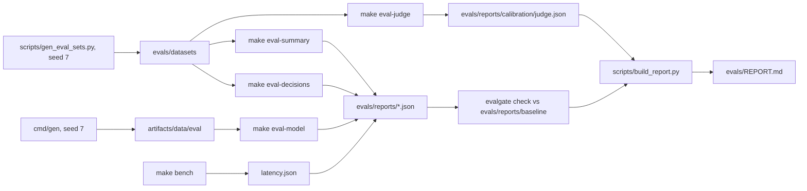

# Evaluation

How the scorer, the model and the case summarizer are evaluated, how the gate decides, and what the latest
reports say. Everything here runs offline on synthetic data unless a section says otherwise. The generated
summary of the latest run is [`evals/REPORT.md`](../evals/REPORT.md); the raw reports are
`evals/reports/*.json` (`evalgate.report.v1`). Only `evals/REPORT.md` and the baselines in
`evals/reports/baseline/` are tracked: `evals/reports/*.json` and `evals/reports/calibration/` are listed in
`.gitignore`, so a fresh clone has them only after the commands below are run.

## Overview



| Suite | What it measures | Data | Runner | Report |
|---|---|---|---|---|
| `model` | Ranking, recall at fixed false-positive rates and calibration of the shipped model plus rules | Temporal test split of the 2M-event eval data | `python -m training.evaluate` (ONNX artifact through `serving/bentoml/runtime.py`, rule flags from the Go engine via `cmd/evaldecide`) | `evals/reports/model.json` |
| `decisions` | Exact action, reason-code set and degraded handling of the real scorer | 150 golden transactions (dev 60 / test 90) | `evalgate run evals/suites/decisions.yaml` with target `cmd/evaldecide` | `evals/reports/decisions.json` |
| `summaries` | Schema validity, faithfulness, pattern accuracy and PII reaching a provider for case summaries | 120 REVIEW cases (dev 48 / test 72) | `evalgate run evals/suites/summaries.yaml`, real summary pipeline, FakeLLM | `evals/reports/summaries.json` |
| judge calibration | Agreement of the usefulness judge with labels known by construction | 80 summaries (dev 40 / test 40) | `python -m evals.graders.judge` | `evals/reports/calibration/judge.json` |
| `latency` | `Score` latency under constant load | ghz against the host stack, ci profile 300 RPS for 60 s | `scripts/bench.sh` and `cmd/benchreport` | `evals/reports/latency.json` |

Dataset sizes are those of spec §11 (`docs/specs/000-build-spec.md`) and `evals/datasets/README.md`.

## Data

### Synthetic transactions (`cmd/gen`)

All data is synthetic. `cmd/gen` writes events and labels with seed 7 (`make gen-data SIZE=demo|eval`,
`SEED ?= 7` in the `Makefile`). The sizes are set in `ConfigFor` in `cmd/gen/generator.go`: `demo` is 200,000
events over 3,000 accounts (training and the demo stack) and `eval` is 2,000,000 events over 30,000 accounts
(the `model` suite). The fraud patterns are described in `cmd/gen/PATTERNS.md`.

**Temporal split.** Every transaction label carries a `split` assigned by event day (`split` in
`cmd/gen/generator.go`): the data covers 24 days from 2026-09-01; the first 4 days are `warmup`, and the
remaining days are cut in time order into `train` (70%), `valid` (15%) and `test`
(the rest). Nothing is shuffled across the cut, so test transactions are always later than training and
validation ones. The model is trained on the demo data (`make train`) and the `model` suite scores the test
days of the eval data; no threshold is fit on test (docs/DECISIONS.md D-037).

### Eval sets (`scripts/gen_eval_sets.py`)

The decision, summary and judge sets are generated by `scripts/gen_eval_sets.py` with seed 7
(`uv run python scripts/gen_eval_sets.py`). Labels are known by construction; the generator never reads model
or summarizer output.

| Set | Dev / test | Label |
|---|---|---|
| `evals/datasets/decisions` | 60 / 90 | Action, reason-code set and degraded flag, written from `rules/rules.v2026.10.2.yaml` and the combination table (rule hits, near misses, band edges, degraded paths) |
| `evals/datasets/summaries` | 48 / 72 | Pattern of the generating scenario in `cmd/gen/PATTERNS.md`; `meta.pii` lists synthetic PII planted in merchant names |
| `evals/datasets/judge_calibration` | 40 / 40 | Useful (written from the facts) or not (wrong pattern, wrong number, absent fact, generic checks) |

Counts are from `evals/datasets/README.md`. Each set has `dev.jsonl`, `test.jsonl` and `cases.v1.jsonl`
(dev then test, the one file a suite reads, D-031). `evals/datasets/MANIFEST.json` pins the SHA-256 of every
file, and `tests/unit/test_eval_sets.py` checks counts, disjoint splits, the manifest and byte-identical
regeneration. Tuning (for example of FakeLLM's rules) uses dev splits only; the Make targets run the test
split.

## The suites and their thresholds

Thresholds come from spec §11 and are written into `evals/suites/*.yaml`; a few `model` thresholds were added
in `evals/suites/model.yaml` under D-037 and are marked below. "Gated" means `evalgate check` enforces the
threshold and the regression rule; "reported" means the metric is in the report but cannot fail the gate.

### `model`

`make eval-model` scores the temporal test split of the eval data with the serving ONNX artifact
(`artifacts/model`) and the active rule set's flags from the Go rule engine. "Combined" flags a transaction
when a rule fires or the score passes the threshold, so rule false positives spend the false-positive budget
first (D-033). Metric values are computed on the whole split; the report's cases are 20 account shards
(CRC-32 of `account_id`) carrying the same metrics, the paired units for the regression check.

| Metric | Meaning | Threshold | Source | Gate |
|---|---|---|---|---|
| `recall_at_1pct_fpr_combined` | Recall of rules plus model at the threshold chosen on `valid` for 1% FPR | ≥ 0.80 | spec §11 | gated |
| `fpr_combined` | Test FPR at that threshold | ≤ 0.015 | `model.yaml` (D-037) | gated |
| `recall_review_band` | Recall of rules OR score ≥ the rule set's review threshold | none | `model.yaml` (D-037) | regression only |
| `fpr_review_band` | FPR of the same policy | ≤ 0.01 | `model.yaml` (D-037) | gated |
| `recall_decline_band` | Recall at the decline threshold | none | `model.yaml` | reported |
| `band_calibration_gap` | Largest gap between mean score and fraud rate over the review and decline bands | ≤ 0.05 | `model.yaml` (D-037) | gated |
| `pr_auc` | Area under the precision-recall curve | ≥ 0.70 | spec §11 | gated |
| `ece` | Expected calibration error | ≤ 0.02 | spec §11 | gated |
| `recall_at_1pct_fpr_combined_test_oracle` | Combined recall with the threshold fit on test | none | `model.yaml` | reported |
| `recall_at_1pct_fpr_model` | Model-only recall at 1% FPR | none | spec §11 ("reported only") | reported |
| `recall_at_1pct_fpr_rules` | Rules-only recall at 1% FPR | none | spec §11 ("reported only") | reported |

The evaluator refuses data whose `gen_version` differs from `cmd/gen` (`GEN_VERSION` in
`training/evaluate.py`).

### `decisions`

`make eval-decisions` sends each case to `cmd/evaldecide`, which decides it through the real
`ScorerServer`, active rule set and combination table, with the feature store and the model stubbed by the
case (13 feature values or `null` for Redis down; a score or "unavailable"). Nothing touches Redis, Postgres,
Kafka or a model server.

| Metric | Meaning | Threshold |
|---|---|---|
| `action_exact` | Action equals the expected APPROVE, REVIEW or DECLINE | 1.0 |
| `reason_code_set` | Reason codes are exactly the expected set, none missing and none extra | 1.0 |
| `degraded_handling` | A degraded case carries the flag and its degraded reason code; a healthy case carries neither | 1.0 |

Thresholds: spec §11 and `evals/suites/decisions.yaml`. Graders: `evals/graders/decisions.py`. This suite
is a conformance check: the expected actions restate the rule text, so 1.0 shows that the engine applies the
YAML rules as written, not that the rules are good (`docs/KNOWN_LIMITATIONS.md`).

### `summaries`

`make eval-summary` runs the real case-summary pipeline (`src/fraud_summarizer/pipeline.py`: load facts,
redact, summarize, validate the schema, check faithfulness) on each test case with
`FRAUD_SUMMARY_PROVIDER=fake`. Every request that reaches a provider is recorded for the PII grader.

| Metric | Meaning | Threshold |
|---|---|---|
| `schema_valid` | The model output passed schema validation (status `ok` or `unfaithful`, not the templated fallback) | 1.0 |
| `faithfulness` | Share of evidence items whose fact key exists and whose statement carries that fact's value (`src/fraud_summarizer/faithfulness.py`) | ≥ 0.95 |
| `pattern_accuracy` | Summary pattern equals the generating scenario's pattern (offline) | ≥ 0.85 |
| `pii_to_provider` | 1 when any planted PII value reached a provider request; see [Redaction and PII](#redaction-and-pii) | 0 |
| p95 latency per case (offline) | Budget `max_p95_ms` in the suite | < 200 ms |

Thresholds: spec §11 and `evals/suites/summaries.yaml`. Graders: `evals/graders/summaries.py`. Two more
metrics are live only (spec §11): judge usefulness ≥ 0.80 and cost per case ≤ USD 0.003
(`THRESHOLDS` in `scripts/eval_live.py`).

### Judge calibration

`make eval-judge` (`evals/graders/judge.py`) runs the usefulness judge of route `judge_usefulness`
(`config/llm_routes.yaml`, prompt `prompts/judge_summary_usefulness.v1.md`) on the test split of
`evals/datasets/judge_calibration` and writes agreement, Cohen's kappa, the confusion matrix and the
disagreements in the `evalgate.calibration.v1` fields (D-036). It passes when agreement is at least 0.8
(spec §11, `AGREEMENT_MIN`) and no judge call failed. Offline the judge is FakeLLM's rule-based judge; a live
judge score counts only after a live calibration passes (`scripts/eval_live.py`). Spec §11 names
`evalgate calibrate`; the vendored evalgate has no such command, so this module does the same job (D-036).

### `latency`

`make bench` (`scripts/bench.sh`) starts the test infrastructure (`compose.test.yaml`), a fresh database, the
BentoML model server on `artifacts/model` and the scorer on the host, warms up for 10 s and drives
`fraud.v1.Scorer/Score` with ghz at the profile's rate (`scripts/bench/score.json`: unique transaction ids,
5,000 accounts, 9,000 devices). `cmd/benchreport` turns the ghz output into a report whose cases are
one-second windows, and fails the run when:

- p95 is over budget: 80 ms on the `ci` profile at 300 RPS (spec §11, NFR-2), or 50 ms with p99 90 ms on
  the `laptop` profile at 2,000 RPS (NFR-1);
- the success rate is under 99.9%;
- the achieved rate is under 95% of the target;
- more than 5% of decisions in the window were degraded (a degraded answer is fast by construction, so it
  would hide the scorer's real latency).

These limits are the constants in `cmd/benchreport/main.go`. `make eval` re-checks an existing
`latency.json` against them (`benchreport -check-only -allow-missing`) but does not run the bench.

### Related checks outside the report

- `make feature-parity` (`scripts/feature_parity.py`) computes the 13 features offline
  (`training/features.py`) for `tests/fixtures/parity/events.jsonl`, runs the Go online path
  (`TestOnlineOfflineParity`, an integration test against Redis) and exits 1 on any mismatch. Last recorded
  result: 3502 transactions x 13 features, 0 mismatches (`PROGRESS.md` T-13).
- `make bench-model` (`scripts/bench_model.py`) measures single-row latency of the model server against a
  p95 budget of 8 ms and writes `evals/reports/model_latency.json`. Last recorded result: p50 2.99 ms,
  p95 4.63 ms, p99 6.65 ms over 2,000 requests (`PROGRESS.md` T-16); that report names model `fraud-gbdt/1`,
  an earlier model than the one the `model` suite evaluates.

## The gate

### `evalgate check`

Each `make eval-*` target that writes a report then runs

```sh
evalgate check evals/reports/<suite>.json --baseline evals/reports/baseline/<suite>.json --max-regression-pp 1.0
```

evalgate `v0.1.0` (pinned in `pyproject.toml` and `uv.lock`, D-072) fails a report when
(`evalgate.stats.gate.check` upstream):

- a gated metric misses its threshold (the gated set is `extensions.gates` in the report);
- the cost or p95 budget in `extensions.budget` is exceeded (the `summaries` suite sets `max_p95_ms: 200`; the
  `latency` suite carries its p95 budget the same way);
- the run measured nothing, a gated metric had errors, or the run health is `degraded`;
- a gated metric regresses against the baseline.

**Regression rule.** For each metric, candidate and baseline cases are paired by case id and the gate takes
the mean difference in percentage points. A gated metric regresses when it is worse than the baseline by more
than 1 pp **and** the 95% paired-bootstrap interval of the difference excludes 0 on the worse side
(`is_regression`). The bootstrap resamples paired cases together, 10,000 times with seed 1337
(`third_party/evalgate/src/evalgate/stats.py`). It fails closed: a gated metric missing from the baseline, or
with fewer than 10 paired cases, is an error. Exit codes are 0 (pass), 1 (gate failed) and 2 (invalid
input).

The paired units are 20 account shards for `model`, one case per transaction or summary for `decisions` and
`summaries`, and one-second windows for `latency`, whose only gated metric against the baseline is the
success rate; its p95 is gated through the budget (D-035).

### Baselines

`evals/reports/baseline/{model,decisions,summaries,latency}.json` are earlier reports. They were first set at
commit beafcea (D-035), and the model baseline was refreshed when the D-037 metrics were added. A baseline
changes only with a reason recorded in `docs/DECISIONS.md` (`.claude/rules/evals.md`).

### `make eval` and `evals/REPORT.md`

`make eval` runs `eval-model`, `eval-decisions`, `eval-summary` and `eval-judge` (each stops the run if its
gate fails), checks `evals/reports/latency.json` against the latency budget if it exists, then runs
`scripts/build_report.py`. `make verify` runs `make eval` and then `make bench`.

`scripts/build_report.py` reads `evals/reports/{model,decisions,summaries,latency}.json`, the baselines and
`evals/reports/calibration/judge.json`, and writes `evals/REPORT.md`:

- the mode: `live` if any report is live, `cassette` if the summaries report names a model that is not a
  `fake-` model (recorded responses replayed offline), otherwise `offline`;
- the summary prompt version and hash, and the commit of the first report it finds;
- one gate verdict per suite, from running the same `check` in-process against the baseline; `model`,
  `decisions` and `summaries` are required, `latency` is optional and is marked "not run" if absent, and the
  judge calibration verdict is one more check;
- a table of every metric with value, threshold, status, baseline and delta, and per suite the command and
  the data behind it;
- the live-eval line: results from `evals/reports/summaries_live.json` if present, otherwise "not run".

The file depends only on the reports (no wall-clock time) and must not be edited by hand. The script exits 1
when the overall gate is not PASS. Do not run `make eval` just to read results: it overwrites the local
reports and the tracked `evals/REPORT.md`.

## Current results

Every number in this section is copied from the file named next to it. The `model`, `decisions` and
`summaries` reports were written on 2026-10-18 at commit 2929005a15; `latency.json` was written on 2026-10-17
at commit f9ab2a5 (`created_at` and `git_sha` in each file), because `make eval` does not re-run the bench.
The JSON reports are local files (git-ignored); `evals/REPORT.md` is the tracked record of the same run.

### Summary

From `evals/REPORT.md`:

- Mode: **offline**. Prompt `case_summary.v1` (sha256 e2bca451625c). Commit 2929005a15.
- Gate: **PASS** (5 of 5 checks pass).
- Live evals (`make eval-live`): not run, no provider key in this environment.

### `model`

From `evals/REPORT.md` (`make eval-model`, values also in `evals/reports/model.json`):

| Metric | Value | Threshold | Baseline | Δ (pp) |
|---|---|---|---|---|
| `recall_at_1pct_fpr_combined` | 0.9161 | ≥ 0.8 | 0.9161 | +0.00 |
| `fpr_combined` | 0.0079 | ≤ 0.015 | 0.0079 | +0.00 |
| `recall_review_band` | 0.8387 | – | 0.8387 | +0.00 |
| `fpr_review_band` | 0.0032 | ≤ 0.01 | 0.0032 | +0.00 |
| `recall_decline_band` | 0.5893 | – | 0.5893 | +0.00 |
| `band_calibration_gap` | 0.0081 | ≤ 0.05 | 0.0081 | +0.00 |
| `pr_auc` | 0.8740 | ≥ 0.7 | 0.8740 | +0.00 |
| `ece` | 0.0007 | ≤ 0.02 | 0.0007 | +0.00 |
| `recall_at_1pct_fpr_combined_test_oracle` | 0.9232 | – | 0.9232 | +0.00 |
| `recall_at_1pct_fpr_model` | 0.9244 | – | 0.9244 | +0.00 |
| `recall_at_1pct_fpr_rules` | 0.6012 | – | 0.6012 | +0.00 |

Run details (`evals/REPORT.md`):

- Data: 2,000,000 events, gen v2, seed 7, sha256 632291c0507e; test split 169,604 transactions, 1,680 fraud.
- Model fraud-gbdt/3 (feature spec v2, onnx sha256 5102bf495868); rules alone flag 0.21% of legitimate
  transactions.
- Threshold chosen on valid: test recall 0.9161 at FPR 0.79%.
- Shipped review threshold 0.3 (rule set 2026.10.2): test recall 0.8387 at FPR 0.32%.
- `evalgate check` against the baseline: **PASS**.

The scorer therefore runs below the 1% FPR operating point; lowering the review threshold is a rule-set
change (`docs/KNOWN_LIMITATIONS.md`).

### `decisions`

From `evals/REPORT.md` (`make eval-decisions`, `evals/reports/decisions.json`):

| Metric | Value | Threshold | Baseline | Δ (pp) |
|---|---|---|---|---|
| `action_exact` | 1.0000 | ≥ 1 | 1.0000 | +0.00 |
| `reason_code_set` | 1.0000 | ≥ 1 | 1.0000 | +0.00 |
| `degraded_handling` | 1.0000 | ≥ 1 | 1.0000 | +0.00 |

90 cases (test split), dataset sha256 127e2b9d8e70; p50 1.3 ms, p95 4.7 ms; cost USD 0.0000. `evalgate check`
against the baseline: **PASS** (`evals/REPORT.md`).

### `summaries`

From `evals/REPORT.md` (`make eval-summary`, `evals/reports/summaries.json`):

| Metric | Value | Threshold | Baseline | Δ (pp) |
|---|---|---|---|---|
| `schema_valid` | 1.0000 | ≥ 1 | 1.0000 | +0.00 |
| `faithfulness` | 1.0000 | ≥ 0.95 | 1.0000 | +0.00 |
| `pattern_accuracy` | 0.9028 | ≥ 0.85 | 0.9028 | +0.00 |
| `pii_to_provider` | 0.0000 | ≤ 0 | 0.0000 | +0.00 |

72 cases (test split), dataset sha256 c1a90b71d766; p50 31.5 ms, p95 50.5 ms; cost USD 0.0000; model
fake-case-summary-v1. `evalgate check` against the baseline: **PASS** (`evals/REPORT.md`).

Pattern accuracy is 65/72 with a 95% CI of 0.833–0.958 (`docs/KNOWN_LIMITATIONS.md`, from the `ci_low` and
`ci_high` of `pattern_accuracy` in `evals/reports/summaries.json`). The lower bound is under the 0.85
threshold, and the number measures FakeLLM, not a real model.

### Judge calibration

From `evals/REPORT.md` (`make eval-judge`): offline, fake-judge-v1, 40 test labels: agreement 0.900
(min 0.8), kappa 0.800: PASS.

Confusion matrix from `evals/reports/calibration/judge.json` (rows: label, columns: judge; 1 = useful):

| Label | Judged 0 | Judged 1 |
|---|---|---|
| 0 | 20 | 0 |
| 1 | 4 | 16 |

The four disagreements (`judge-010`, `judge-044`, `judge-058`, `judge-072`) are all useful summaries judged
not useful; `judge_errors` is 0 (`evals/reports/calibration/judge.json`). This calibrates FakeLLM's judge,
whose pattern test reuses FakeLLM's classifier (`evals/REPORT.md`), so it says nothing about a live judge.

### `latency`

From `evals/REPORT.md` (`make bench`, `evals/reports/latency.json`):

| Metric | Value | Threshold | Baseline | Δ |
|---|---|---|---|---|
| `degraded_rate` | 0.0094 | ≤ 0.05 | 0.0087 | +0.07 pp |
| `p95_ms` | 19.6 ms | ≤ 80 | 21.8 ms | -2.2 ms |
| `p99_ms` | 30.5 ms | – | 28.4 ms | +2.2 ms |
| `success_rate` | 1.0000 | ≥ 0.999 | 1.0000 | +0.00 pp |

Profile ci: 300 of 300 rps for 60 s; p50 11.3 ms, p95 19.6 ms, p99 30.5 ms (budget p95 80 ms). Degraded
decisions in the window: 169 of 17,999. `evalgate check` against the baseline: **PASS** (`evals/REPORT.md`).

The bench shares a 4-vCPU container with the whole stack, so the degraded share depends on host load, and the
`laptop` profile target (NFR-1) is not met there (`docs/KNOWN_LIMITATIONS.md`, "Model server throughput on a
shared host").

## What is offline and what is not

### Offline: FakeLLM and cassettes

`make eval-summary` sets `FRAUD_SUMMARY_PROVIDER=fake`, and `make eval-judge` defaults
`FRAUD_JUDGE_PROVIDER` to `fake`, so both use FakeLLM (`src/fraud_summarizer/llm/fake.py`). FakeLLM is
deterministic: rules map reason codes and features to a pattern, and the evidence cites the three most
extreme features with their exact values. It reads only fact keys and numeric feature values, so text in
merchant names cannot steer it. Its rules were tuned on the dev split only. Python tests run under
pytest-socket, offline by default (`.claude/rules/python.md`).

Cassettes are recorded provider responses in `tests/fixtures/llm/<route>/<key>.json`, keyed by a SHA-256 of
route, model, prompt version, messages and schema name (`src/fraud_summarizer/llm/cassettes.py`). When a
recorded cassette matches a request, FakeLLM replays it instead of applying its rules, and
`scripts/build_report.py` then labels the run `cassette`. No case-summary cassette is recorded today:
`tests/fixtures/llm/case_summary/` holds no files, and the files in `tests/fixtures/llm/adapters/` were written
by hand from provider documentation to test the adapters, not recorded (`tests/fixtures/llm/README.md`).
`make record-fixtures` records real responses, within `LIVE_EVAL_BUDGET_USD`, and needs a provider key.

### Live: `make eval-live`

`make eval-live` (`scripts/eval_live.py`) needs a provider key (`ANTHROPIC_API_KEY` or `ANTHROPIC_AUTH_TOKEN`
for the default provider, `OPENAI_API_KEY` for `openai`; `KEY_VARS` in `evals/live.py`). It:

1. calibrates the live judge on the judge calibration test split and writes
   `evals/reports/calibration/judge_live.json`; judge scores count only when agreement is at least 0.8;
2. summarizes the summaries test cases with the configured provider and grades them like `make eval-summary`,
   plus judge usefulness (≥ 0.80) and cost per case (≤ USD 0.003);
3. writes `evals/reports/summaries_live.json` (mode `live`), which `scripts/build_report.py` adds to
   `evals/REPORT.md` with date, model and cost.

Every response is charged at the list price in `config/llm_routes.yaml` against `LIVE_EVAL_BUDGET_USD`
(default 2 in the `Makefile`), and no case starts once the budget is spent (D-036). Without a key the script
prints why and exits 1, writing nothing. `make verify` does not include it.

**Live evals have not been run**: there was no provider key in this environment, and every number on this
page is offline (`evals/REPORT.md`, spec §19 step 4).

### Cost

Offline runs cost USD 0.0000 (`evals/REPORT.md`, decisions and summaries). The live budget is cost per case
≤ USD 0.003 (spec §11). The Anthropic adapter marks the system prompt with `cache_control`
(`src/fraud_summarizer/llm/anthropic_adapter.py`), but `PROGRESS.md` records that the case-summary system
prompt is shorter than the minimum cacheable prefix, so the cache is not used today.

### Limits of these results

From `docs/KNOWN_LIMITATIONS.md`:

- **Synthetic data.** All data comes from `cmd/gen` with seed 7, and its patterns were designed to be
  learnable from the 13 features; the metrics say nothing about production fraud. Fraud is easier to catch at
  night because of how the generator times incidents.
- **The temporal test measures sampling variation, not drift**: train and test are independent draws from a
  generator that does not change over time. Demo and eval data share identifiers because both use seed 7.
- **ONNX parity is checked on demo data only.**
- **The decisions suite is a conformance check** of the rules as written.
- **Offline pattern accuracy measures FakeLLM, not a real model**, and faithfulness is 1.0 by construction
  because FakeLLM quotes fact values verbatim. A live model may phrase evidence without the value, which
  lowers faithfulness; watch it in `make eval-live`.
- **A hard subset is indistinguishable from the facts** (legitimate splurges that look like friendly fraud,
  first purchases with no 24-hour baseline) and counts as misses for any summarizer that reads only the facts.
- **`new_device` is 0 on some P2P cases** in the summaries set (v1) where feature spec v2 would give 1; no
  label depends on it, and the test partition is fixed only by generating a v2 set.
- **`pii_to_provider = 0` covers the planted formats only** (next section).

## Redaction and PII

The summarizer redacts every fact before any provider call (`redact` step in
`src/fraud_summarizer/pipeline.py`, `redact_text` in `src/fraud_summarizer/redact.py`). Two checks measure
it on eval data.

### `pii_to_provider` in the summaries suite

- **Planting.** `scripts/gen_eval_sets.py` appends one synthetic PII value to the merchant name of every third
  summaries case (cut to 120 characters) and lists it in the case's `meta.pii`. `PII_FORMATS` has seven
  formats, all reserved or test values: an email at `example.com`, two phone layouts, a 10-digit phone with
  no separators, and the test card number with spaces, dashes or dots. The set deliberately included formats
  the redactor was known to miss, so that zero is a measurement and not true by construction (D-031). Some
  other cases carry a prompt-injection string instead (`INJECTIONS`).
- **Measuring.** The grader wraps every provider of the gateway in a recorder that keeps the system and user
  text of each request (`_Recorder` in `evals/graders/summaries.py`). `pii_to_provider` is 1 for a case when
  any planted value is an exact substring of what was sent, and the suite gates its mean at 0
  (`direction: lower`, `threshold: 0.0` in `evals/suites/summaries.yaml`).
- **Result.** 0.0000 on the 72 test cases (`evals/REPORT.md`).
- **Scope.** Only the seven planted formats are measured; names, street addresses, IBANs and non-US phone
  layouts are not (`docs/KNOWN_LIMITATIONS.md`). Redactor behaviour on many more shapes is covered by unit
  tests in `tests/unit/test_redact.py`.

### Redaction parity (`scripts/redact_parity.py`)

When the redactor changes, `scripts/redact_parity.py` shows what the change does to real eval inputs. It
collects every string value in `evals/datasets/*/*.jsonl`, redacts each with the working-tree redactor and
with `src/fraud_summarizer/redact.py` as it was at `--rev` (read with `git show`), and prints the counts and
every unique value on which the two disagree. It is read-only and not part of `make eval`:

```sh
uv run python scripts/redact_parity.py --rev <revision>
```

Recorded runs (`docs/KNOWN_LIMITATIONS.md`): `--rev 1d1b596` found 3 of 6,488 unique strings changed, device
hashes that contain a Luhn-valid digit run and are now redacted as cards (D-058); `--rev 1b7c746` found 0 of
6,488 unique values differ.

## How to run

Run from the repository root after `make bootstrap`.

| Command | What it does | Needs | Writes |
|---|---|---|---|
| `make eval` | `eval-model`, `eval-decisions`, `eval-summary`, `eval-judge`, the latency budget check, then `scripts/build_report.py` | Everything below except Docker | All reports below and `evals/REPORT.md` |
| `make eval-model` | `python -m training.evaluate` on the eval data, then `evalgate check` | A trained model in `artifacts/model` (`make train`); generates `artifacts/data/eval` if missing; Go | `evals/reports/model.json` |
| `make eval-decisions` | `evalgate run evals/suites/decisions.yaml --split test`, then `evalgate check` | Go (builds `cmd/evaldecide`) | `evals/reports/decisions.json` |
| `make eval-summary` | `evalgate run evals/suites/summaries.yaml --split test` with FakeLLM, then `evalgate check` | Nothing external | `evals/reports/summaries.json` |
| `make eval-judge` | `python -m evals.graders.judge --split test` | Nothing external | `evals/reports/calibration/judge.json` |
| `make eval-live` | `scripts/eval_live.py` within `LIVE_EVAL_BUDGET_USD` | A provider key | `evals/reports/calibration/judge_live.json`, `evals/reports/summaries_live.json` |
| `make bench` | `scripts/bench.sh` with `BENCH_PROFILE=ci` (or `laptop`), `BENCH_DURATION` (default 60s) | Docker, ghz, Go; trains a model if none exists | `evals/reports/latency.json`, logs in `artifacts/bench/` |
| `make bench-model` | `scripts/bench_model.py` | A trained model | `evals/reports/model_latency.json` |
| `make feature-parity` | `scripts/feature_parity.py` | Go, Redis for the integration test | `artifacts/parity/` |

Every target except `make feature-parity` overwrites its report under `evals/reports/` (git-ignored), and
`make eval` also rewrites the tracked `evals/REPORT.md`. To try a change on dev data without touching the
test-split reports, write elsewhere, for example
`PYTHONPATH=$PWD FRAUD_SUMMARY_PROVIDER=fake uv run evalgate run evals/suites/summaries.yaml --split dev --out artifacts/summaries-dev.json`.
Tune on dev splits only; never adjust anything to pass the test split, and never lower a threshold to get
green (`CLAUDE.md`).

When a gate fails, the `eval-analyst` subagent (`.claude/agents/eval-analyst.md`) compares the reports with
the baselines and groups failing cases by cause. After `make eval`, the `eval-report` skill explains the
deltas in `evals/REPORT.md`.

## Adding a case

Use the `add-eval-case` skill (`.claude/skills/add-eval-case/SKILL.md`):

1. Extend `scripts/gen_eval_sets.py`, dev split first.
2. Regenerate with `uv run python scripts/gen_eval_sets.py` and review the diff; `MANIFEST.json` changes with
   it and `tests/unit/test_eval_sets.py` must pass.
3. If a test partition changes, record the reason in `docs/DECISIONS.md` and refresh the baseline.
4. Run `make eval`.

Never edit `evals/datasets/**/test*.jsonl` by hand after generation (`CLAUDE.md`): test partitions are only
regenerated. The PreToolUse hook `.claude/hooks/pre_tool_guard.py` blocks edits to those paths. A new fraud
pattern goes through the `add-fraud-pattern` skill, which carries it from `cmd/gen` to the eval sets and the
summarizer.
